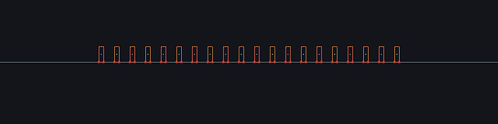
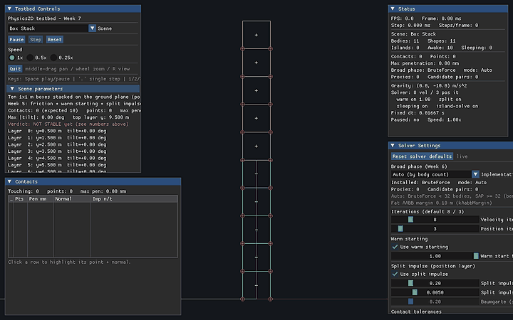
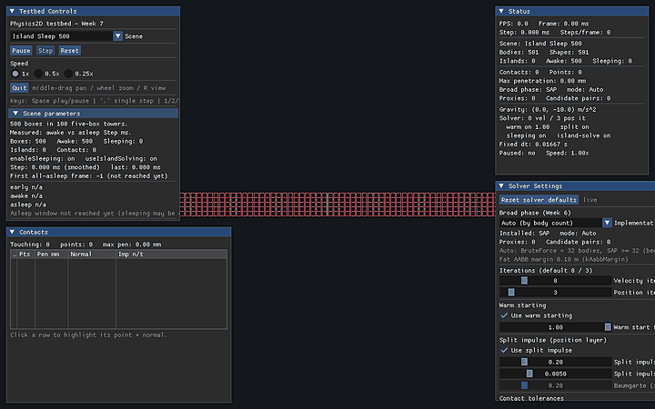
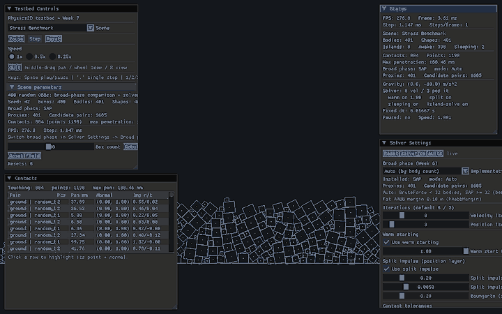
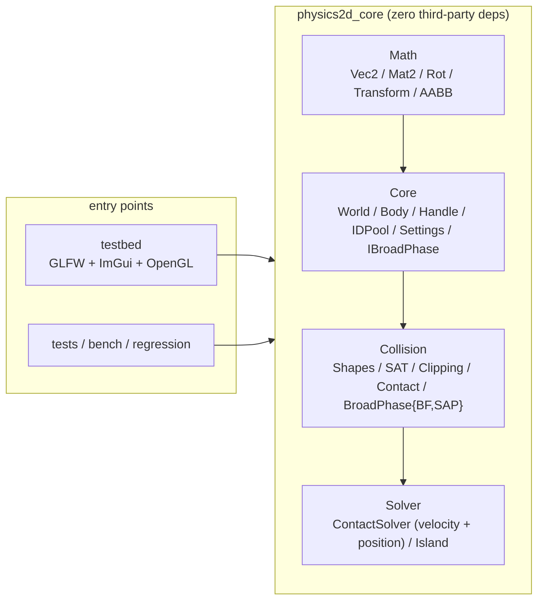

# Physics2D — A 2D rigid body physics engine written from scratch

> Chinese version: [README.md](README.md)

[](https://github.com/baisctong/Physics2D/actions/workflows/ci.yml)
[](https://github.com/baisctong/Physics2D/releases)

> A C++20 project built for new-grad resumes and deep interview discussion: it implements the
> complete physics pipeline **broad phase → narrow phase → contact manifold → Sequential Impulse
> solving → islands / sleeping** from scratch. The physics core has zero third-party dependencies,
> runs headless, and ships with measured numbers and deterministic regression.

**v1.0-release (Weeks 1-8 complete)**: math library; Body/World integration skeleton; shape system
and analytic collision; **convex-polygon SAT + clipping-based manifold + SATCache**;
**Coulomb friction cone + warm starting + split impulse**; **a 10-box stack stable for 10 seconds**;
**pluggable broad phase (BruteForce + SAP, 7.70x on 2000 bodies)**;
**island partition + per-island solving (three modes bit-identical) + whole-island atomic sleeping
(1.7x with 500 bodies asleep)**; **headless deterministic regression (quantized weak hash)**;
an **interactive testbed with 8 demos**; **boundary-contract tests** and complete documentation
([`docs/`](docs/)).

| 20-domino chain wake | 10-box tower, stable for 10 s |
| --- | --- |
|  |  |
| **500 boxes / 100 islands, whole-island sleeping (1.7x)** | **400-box stress scene (SAP broad phase)** |
|  |  |

> Also [contact_debug.gif](docs/images/contact_debug.gif): contact-normal overlay plus the accumulated
> impulse / friction-cone panels. The GIFs are recorded deterministically by the testbed's
> frame-capture mode (`--capture-dir`, new in Week 8); one command reproduces all of them:
> `powershell -NoProfile -ExecutionPolicy Bypass -File scripts/record_gifs.ps1`.
> Recording parameters, panel tour and demo watch-points: [`docs/demos.md`](docs/demos.md).

## ✨ Features

- **Complete physics pipeline, no third-party physics library**: four layers
  `Math → Core → Collision → Solver`; `physics2d_core` depends only on the C++20 standard library and
  can be built/run headless; the layering rule is enforced by a grep job in CI.
- **Broad phase**: `BroadPhaseBruteForce` (O(N²) reference baseline) + `BroadPhaseSAP`
  (endpoint array + temporally coherent incremental sorting); **7.70x** measured in Release for
  2000 bodies over 1000 frames; **switching the broad phase leaves the physics bit-identical**.
- **Narrow phase**: analytic paths for circle/plane + **convex-polygon SAT**
  (reference/incident face + Sutherland–Hodgman clipping, 2 contact points for face-face) +
  feature-encoded `ContactID` (stable across frames) + `SATCache` axis hysteresis.
- **Sequential Impulse solver**: accumulated-impulse clamping, **Coulomb friction cone**,
  **warm starting** (full inheritance, `warmStartFactor=1.0`), **split impulse** as a separate
  pseudo-velocity position layer (no energy injected into real velocities), restitution velocity
  threshold, Baumgarte comparison baseline.
- **Stable stacking (milestone)**: a 10×1 m box tower stays stable for 600 steps (10 s) at the
  default 8 velocity iterations / 3 position iterations: max penetration **5.223 mm** (< 10 mm),
  top box y 9.478 m, max tilt 0.0046 rad.
- **Islands and sleeping**: explicit-stack DFS partition of the contact graph (canonical order),
  three per-island solving modes (`flat` / **`grouped-direct` default** / `grouped-packed` opt-in)
  **bit-identical**, **whole-island atomic sleeping/waking** (4 external entry points + broad-phase
  proximity wake); sleeping islands skip AABB updates/narrow phase/solving while keeping their
  proxies and previous-frame contacts; Step is **1.7x** faster once 500 boxes are asleep.
- **Engineering and quantification**: `physics2d_bench` (broad-phase A/B, median + JSON),
  `physics2d_regression` (quantized weak hash + golden + CTest + CI job), GoogleTest
  (Eigen cross-validation + death tests), ASan/UBSan, CMake presets
  (Debug/Release/Sanitize/Headless + VS2022 fallback), GitHub Actions
  (Linux/Windows + sanitize + headless + regression + layering guard).
- **Interactive testbed**: GLFW + OpenGL 3.3 Core + Dear ImGui (docking), **8 demos**, live
  parameter editing, broad-phase switching, islands/awake/sleeping counters, contact normals /
  penetration / **accumulated-impulse bars with friction-cone usage**, Space pause / `.` single
  step / 1-2-3 slow motion, frame-capture recording.

## 🚀 Quick Start (5 minutes for a newcomer)

Prerequisites: Windows 10/11 + **VS2022 C++ workload** + CMake ≥ 3.25 + Git
(Ninja is located automatically from the VS installation by the script);
on Linux you need g++/clang + cmake + ninja + X11/OpenGL development packages.

```powershell
# 1) One-time environment check (VS2022 workload, CMake, Git, Ninja)
powershell -NoProfile -ExecutionPolicy Bypass -File scripts/bootstrap.ps1

# 2) Configure + build + run all unit tests (first run fetches gtest/Eigen/GLFW/ImGui via FetchContent, 1-2 min)
powershell -NoProfile -ExecutionPolicy Bypass -File scripts/build.ps1 -Preset debug -RunTests

# 3) Launch the testbed: switch between the 8 demos in the dropdown
#    (Space pause / '.' single step / 1-2-3 slow motion / R reset camera)
.\build\debug\testbed\physics2d_testbed.exe
```

Linux:

```bash
sudo apt install -y build-essential cmake ninja-build libgl1-mesa-dev xorg-dev
./scripts/build.sh debug --tests
```

> Dependencies (GoogleTest / Eigen / GLFW / Dear ImGui) are pulled by CMake `FetchContent` on the
> first configure; **vcpkg is not used**. Details: [`docs/dev-setup.md`](docs/dev-setup.md).
> To simply confirm "the project is alive", to do a manual acceptance pass, or to run
> bench/regression/death tests: see [`docs/testing.md`](docs/testing.md)
> (30-second version / full acceptance / 10-minute manual acceptance script / FAQ).

## 🏗️ Architecture



**The 11 phases of `World::Step` (order is fixed)**:

```text
1 IntegrateForces → 2 UpdateBroadPhase → 3 UpdateContacts (narrow phase + proximity wake)
→ 4 BuildIslands → 4b PrepareConstraints → 5 WarmStart → 6 SolveVelocity ×N
→ 7 IntegratePositions → 8 SolvePosition ×M (split impulse) → 9 Synchronize
→ 10 UpdateSleep (whole-island atomic) → 11 Validate (NaN/Inf)
```

- **Layering rule**: `physics2d_core` includes no rendering/UI headers (Tracy is the single
  exception, through zero-cost macros); CI enforces this with grep. `World` only forward-declares
  `ContactSolver`, so Core's public headers never pull the Solver into a translation unit.
- **Determinism**: fixed dt (1/60; the accumulator is the only place where wall-clock time is
  converted), iteration order determined by `vector` indices, candidate pairs canonicalized to
  `(i<j, sorted, deduped)`, island partition in canonical order; `unordered_map` iteration order is
  never used.
- One diagram explains module dependencies + Step timing + the island/sleep state machine + data
  ownership: see [`docs/architecture.md`](docs/architecture.md) (6 Mermaid diagrams).

## 📐 Core Algorithms (full derivations in [`docs/math.md`](docs/math.md))

**SAT (2D)**: two convex polygons only need to be tested against their edge-normal axes
(2D does not need the 3D edge-cross axes). For each edge, take the outward normal `n` and project
both polygons; the axis of maximum separation / minimum penetration becomes the normal (strictly
A→B). The face owning that axis is the **reference face**; the edge of the other polygon whose
normal is most anti-parallel is the **incident face**; `ClipSegmentToLine` performs the side clips
plus the reference-face clip, producing 0–2 contact points.
`ContactID = referenceEdge | incidentVertex<<4 | type<<8` (no `flip` bit; the key is unchanged when
A/B are swapped — the prerequisite for cross-frame warm-start matching).

**Constraint impulse (effective mass)**: the relative velocity at a contact point is
`vRel = (vB + ωB×rB) − (vA + ωA×rA)`, and its normal component is `vn = vRel·n`.
Applying impulse `λ` gives `Δvn = λ·K_n`, where

```text
K_n = 1/mA + 1/mB + (rA×n)²/IA + (rB×n)²/IB        (tangent K_t replaces n with t = Skew(n))
λ   = −vn / K_n                                       (accumulated clamp: accN = max(accN+λ, 0))
```

**Friction cone**: the tangent impulse clamps the **accumulated** value (not the increment):
`accT = Clamp(accT+λt, −μ·accN_new, +μ·accN_new)`; the normal constraint is solved before the
tangent one (the cone radius uses the updated `accN`), and `μ = sqrt(μA·μB)` is combined once by
`World` when the contact is created.

**Warm starting**: `ContactPoint`'s accumulated impulses are inherited across frames by
`ContactID::Key()`; `Prepare` seeds them (`acc = inherited × warmStartFactor`, default 1.0) and
`WarmStart` applies them exactly once. Measured: factor < 1 throws away the converged solution every
frame and re-injects PGS ordering bias — on the 10-box tower over 600 steps, 0.85 collapses at
step 259 while 1.0 does not collapse.

**Split impulse (position layer)**: position correction does not pollute real velocities — a
separate pseudo-velocity layer runs after `IntegratePositions`, recomputes lever arms against the
new transforms, targets `target = (β/dt)·max(0, penetration − slop)`, and after the iterations
integrates the pseudo-velocities once and zeroes them. Measured on a resting box with a **0.10 m
deep overlap**: real-velocity injection **0.000000 m/s** (on) vs **1.139999 m/s** (Baumgarte
baseline); the 2 cm shallow-overlap case corresponds to a 0.18 m/s Baumgarte target and is asserted
separately in `test_solver_split_impulse`.

**Islands and sleeping**: only dynamic-dynamic contacts are edges of the island graph
(static/kinematic bodies are boundaries; otherwise a shared ground plane would merge every stack
into one island). Explicit-stack DFS finds the connected components, then canonical ordering;
sleeping is **whole-island atomic** (every member must satisfy `|v| < 0.01 m/s`,
`|ω| < threshold` for 0.5 s continuously before the whole island sleeps). Sleeping islands do no
work but keep their proxies/contacts; waking is always whole-island (external force/impulse/
transform, or broad-phase proximity overlap).

## 📊 Performance (real Release measurements; full tables and conditions in [`docs/profiling.md`](docs/profiling.md))

**Measurement environment**: Windows 11 22631 / Intel i7-12650H / 16 GB / RTX 4060 / MSVC 19.44
(`/W4 /permissive-`) / CMake 3.31.12 / Ninja 1.12.1 / **RelWithDebInfo** (Release preset).
The bench uses seed 42, discards the first 100 frames as warm-up and reports the median; local noise
is ±2–5%.

**Broad phase A/B (`physics2d_bench`, N random boxes, 1000 frames; only `UpdateAABB + QueryPairs`)**:

| Bodies | BruteForce ms/frame | SAP ms/frame | Speedup | Candidate pairs/frame | True overlaps/frame |
| ---: | ---: | ---: | ---: | ---: | ---: |
| 50 | 0.0034 | 0.0016 | 2.12x | 3.4 | 1.8 |
| 200 | 0.0839 | 0.0173 | 4.88x | 55.3 | 31.3 |
| 500 | 0.5466 | 0.0931 | 5.92x | 354.3 | 202.5 |
| 2000 | 9.3061 | 1.2084 | **7.70x** | 5670.6 | 3206.6 |

Small-N inversion (SAP endpoint maintenance overhead): N=5 0.00x / 10 0.50x / 20 1.00x / 50 2.00x;
crossover refined to **N≈24–26** (W6 first recorded N≈25–32, same order of magnitude; the testbed's
Auto threshold conservatively stays 32). **Every number is reproducible with one command**
(see profiling.md).

**Island sleeping (IslandSleep500: 500 boxes = 100 five-box towers, Release, 600 steps)**:

| Phase | Mean Step time | Relative |
| --- | ---: | ---: |
| Never sleeping (sleeping-off control, Release gtest) | 0.5557 ms | 1.00x |
| Fully asleep (from frame 105 / 1.75 s, Release gtest) | 0.2772 ms | **≈2.00x** |
| Testbed "awake window" (mixed window, canonical end-to-end) | 0.4634 → 0.2656 ms | **1.74x** |

Debug build of the same scene: 4.95 → 2.94 ms (1.69x); 10-box tower in debug: 3.30x
(87.5 → 26.5 µs/step, sleep step 859; W7 historical, same machine). The broad-phase sweep and contact
reuse are still paid while asleep, so the speedup is not an order of magnitude. **Both numbers are
real**: 1.70–1.74x is the testbed's mixed "awake window" figure (two W8 measurement sessions, quoted
externally), ≈2.0x is the pure all-awake vs all-asleep figure (see profiling §3.2 / §1.5).

**Three per-island solving modes (400 bodies / 760 contacts in one island, 40 reps, 8 iterations)**:
flat 1.860 ms / `grouped-direct` (default) 1.908 ms (0.97x, within noise) / `grouped-packed` (opt-in)
2.137 ms (**0.87x, ~15% slower than flat**); at 32 iterations 7.056 / 7.570 (0.93x) / 7.928 (0.89x).
Conclusion: at this scale the whole Body array (≈80 KB) already fits in L2, so the per-frame packing
copy costs more than the locality it buys; packed stays off by default. The real island win is
skipping sleeping islands and culling separate islands (1.74x above).

**Build/test time (canonical clean configure + build + ctest, FetchContent included)**:
debug **50.1 s** / release **53.6 s** / sanitize (ASan) **86.0 s**. Test counts and three-preset results are in
the next section.

## 🎮 Demos (8; controls/panels/recording in [`docs/demos.md`](docs/demos.md))

| Demo | Content | What to look for |
| --- | --- | --- |
| `FallingBall` | Ball drop + gravity/material sliders | 5 mm penetration, restitution threshold |
| `SphereStack` | 3-sphere stack | gradually falls asleep (sleeping=3) |
| `BoxStack` | **10-layer box tower** | stable for 10 s; can throw a ball at it / reset; 3 iterations visibly softens it |
| `FrictionRamp` | Incline μ vs tanθ | at 15°, μ=0.30 > tanθ stays static; μ=0.1 slides |
| `Pyramid200` | Perfect box pyramid (4–24 layers, default 16 layers = 136 boxes) | load/iteration budget and bottom-row penetration |
| `StressBenchmark` | 400 random boxes | broad-phase candidates/proxies, SAP path |
| `Dominoes` | 20 dominoes | push the first after sleeping → **20/20 chain wake, none skipped** |
| `IslandSleep500` | 500 boxes / 100 islands | awake 500→0, Step-time comparison before/after sleeping |

Panels: Solver parameter sliders (iterations/warmFactor/split impulse/friction/restitution/gravity…),
Broad phase dropdown (Auto/None/BruteForce/SAP), Status (Step time/FPS/islands/awake/sleeping),
Contacts debug (normals/penetration/accumulated-impulse bars + friction-cone usage, click to
highlight). Keys: `Space` pause, `.` single step, `1/2/3` slow motion, middle-mouse drag to pan,
wheel to zoom, `R` reset camera.

## 🧪 Testing and Deterministic Regression

- **Test scale (v1.0 final source)**: debug/sanitize **387 ctest cases**, release **390** (3 extra
  release-only contract tests); = 386 GoogleTest cases (31 of them death tests that auto-SKIP inside
  the sandbox and run in CI) + 1 `regression_default` regression case. All three presets green,
  MSVC `/W4 /permissive-` **0 project warnings**. Running the test executable outside the workspace
  → **386/386 gtest all pass** (the 31 death tests really execute).
- **Deterministic regression**: `physics2d_regression` replays a fixed 600-step scene; the
  quantized weak hash (quantum 1e-5) **`588d30e70f9b4ddd`** matches the golden file
  (CTest `regression_default` + CI job); exit codes: 0 match / 1 mismatch / 2 usage or IO error.
  Pure refactors (broad-phase switch, island grouping) must not change the hash.
- **Equivalence evidence (optimizations do not change physics)**:
  - the same scene with no broad phase / BruteForce / SAP over 300 steps is **bit-identical at
    545 floats per frame** (body state + contact list including accumulated impulses); switching
    the broad phase at runtime for 150 steps is bit-identical to a reference World;
  - SAP vs BruteForce on 10 random scenes (N=50/200/500) × 1000 frames = 10,000 frames with
    identical pair sets (**677,584 pair comparisons, 0 mismatches**);
  - flat / grouped-direct / grouped-packed three solving modes: two-island 276 + dense single-island
    21,760 float comparisons, **0 differences**; World-level 300 steps × 469 floats/step
    bit-identical;
  - testbed `--broadphase none|bf|sap`: the body/contact output lines have the **same SHA-256**.
- **Boundary contracts**: degenerate polygons / zero density / non-finite input / extreme velocities /
  very long thin boxes / extreme mass ratios / illegal World lifecycle are covered by asserts or
  explicit documentation; see [`docs/boundary-contracts.md`](docs/boundary-contracts.md) and the
  corresponding `tests/unit/test_boundary_*.cpp`.

## 📁 Directory

```text
include/physics2d/{Math,Core,Collision,Solver}/   # public headers (frozen API)
src/{Math,Core,Collision,Solver}/                 # core static-library implementation
testbed/                                          # GLFW + ImGui testbed + 8 demos + SceneBuilders
tests/unit/                                       # GoogleTest unit tests (incl. boundary contract tests)
tests/regression/                                 # headless deterministic regression + golden
bench/                                            # headless broad-phase benchmark
docs/                                             # architecture/math/profiling/boundary/demos/testing/setup/devlog
scripts/                                          # bootstrap / build / format / record_gifs
```

## 📚 Docs Map

| Document | Content |
| --- | --- |
| [`docs/architecture.md`](docs/architecture.md) | module dependencies, data layout, Step 11-phase timing, island/sleep state machine, broad-phase/narrow-phase/solver data flow (with a Mermaid overview) |
| [`docs/math.md`](docs/math.md) | full derivations of SAT/impulses/friction cone/warm starting/split impulse/island sleeping + interview follow-ups |
| [`docs/profiling.md`](docs/profiling.md) | all measured performance tables (broad phase/sleeping/three solving modes/build time) + environment and measurement discipline |
| [`docs/boundary-contracts.md`](docs/boundary-contracts.md) | boundary-scenario contract table (asserts/return values/documented limits) and known limitations |
| [`docs/demos.md`](docs/demos.md) | 8 demo descriptions, controls, panel explanations, GIF recording commands |
| [`docs/testing.md`](docs/testing.md) | manual test guide: 30-second version / full acceptance / 10-minute manual acceptance script / smoke / bench / regression / death tests |
| [`docs/devlog.md`](docs/devlog.md) | weekly reports (done / stuck / data / next / reminders) — interview material |
| [`docs/dev-interfaces.md`](docs/dev-interfaces.md) | 18 reserved-interface statuses, deviation registry, invariants that must not break |
| [`docs/ROADMAP.md`](docs/ROADMAP.md) | 8-week plan and per-week acceptance records |
| [`docs/resume-interview.md`](docs/resume-interview.md) | resume bullets (with measured numbers), 25 interview questions, 20-minute walkthrough script |
| [`docs/release-notes-v1.0.md`](docs/release-notes-v1.0.md) | v1.0-release notes (highlights / boundaries / verification checklist) |
| [`README.md`](README.md) | Chinese version of this README |
| [`HANDOFF.md`](HANDOFF.md) | session handoff: current state, verification baseline, red lines and pitfalls |

## ⚠️ Known Limitations (v1.0, honest list)

- **A 30:1 single column collapses at the default 8 velocity iterations**: PGS has to propagate
  support through 30 layers every frame, and 8 iterations do not have enough propagation budget
  (10 boxes is the 8-iteration acceptance scene; 30 boxes need ~32 velocity iterations to stand).
  Likewise, **a pyramid whose bottom rows carry 16+ boxes shows steady-state penetration beyond
  10 mm** (a load/iteration-budget property, not a bug): Pyramid200's default 16 layers / 136 boxes
  measures 29.7 mm / 1.36°; 20 layers / 210 boxes measures 100.5 mm / 6.02°.
- **Sleep onset is limited by residual jitter**: the 10-box tower needs ~859 steps (14.3 s) to
  satisfy the 0.5 s quiet window; thinner upright pieces (<0.2 m) can hardly sleep at all under the
  current point-by-point PGS. The root cause is the ordering bias of solving two contact points
  sequentially, and the correct fix is a **2-point-contact 2×2 block solver** (the highest-priority
  v1.1 tech debt). The repository did not raise `kSleepLinearTolerance` (kept at the design value
  0.01) just to make the number look better.
- **`Body` is still a single struct** (with cold/hot partitions in comments plus hot fields added
  in W5-W7): the `BodySim`/`BodyState` split was deferred W4→W8 and then dropped — the W7
  measurement showed that "intra-island packing" is slower at 400 bodies; the W8 re-measurement gives 0.87x (about 15% slower than flat), and profiling
  profiling found no evidence that body layout is the hotspot; it is a v1.1 candidate.
- **Per-island body packing is off by default** (`packIslandBodies=false`): measured 0.87x in
  Release (see above); it stays as an opt-in path covered by bit-identity tests.
- **Shapes and CCD**: collision shapes are limited to convex polygons (≤8 vertices) / circles /
  infinite planes; concave polygons (must be split by the user), capsules and **CCD/TOI** are not
  supported (a fast small body can tunnel; single-step motion is clamped by `kMaxTranslation`, but
  that is not continuous collision detection).
- **No joint system / no multithreading**: joints (revolute/prismatic/…) and island-level parallel
  solving are not implemented (islands are independent by construction; per-island parallelism is
  the v1.1 starting point).
- **Tracy only has zero-cost hooks** (`Core/Profiler.h` + CMake option); full integration is
  deferred to v1.1; v1.0 performance data comes from `physics2d_bench` and the testbed Status panel.
- **Rendering interpolation is not implemented** (`StepAccumulator::GetAlpha()` is reserved): slow
  motion and single stepping work, but at high refresh rates motion still updates once per physics
  step.
- **The testbed needs a working OpenGL 3.3 context** (unavailable over Remote Desktop / without a
  GPU); use `--smoke` in display-less environments.
- **Determinism scope**: bit-identical on the same platform/compiler; across platforms we rely on the
  quantized weak hash (1e-5) and do not guarantee bit-exactness.
- **Incremental builds on this machine are not trustworthy (environment issue, not an engine
  issue)**: with a Chinese-locale MSVC, `/showIncludes` prevents Ninja from recording header
  dependencies, which can mix class layouts and trigger HEAP CORRUPTION; `scripts/build.ps1` now
  auto-detects headers newer than objects and forces clean-first (details in
  [`docs/dev-setup.md`](docs/dev-setup.md) §6).

## 🗺️ Roadmap

**v1.0-release completed (Weeks 1-8)**:

| Week | Topic | Status |
| --- | --- | --- |
| W1 | Math library + CMake + render loop + integration skeleton | ✅ |
| W2 | Shapes/plane/circle analytic collision + Contact persistence | ✅ |
| W3 | Sequential Impulse (normal) + SphereStack | ✅ |
| W4 | SAT + clipping manifold + SATCache + first BoxStack | ✅ |
| W5 | Friction/warm starting/split impulse + **10-box stack stable for 10 s** | ✅ |
| W6 | BruteForce + SAP + **7.70x on 2000 bodies** + bench + headless regression | ✅ |
| W7 | Island partition/per-island solving + **whole-island sleeping (1.7x)** + Dominoes/IslandSleep500 | ✅ |
| W8 | Architecture/math/profiling/README+GIFs/boundary contracts/resume+interview + **v1.0-release** | ✅ |

**v1.1+ (by priority)**:

1. **2-point-contact 2×2 block solver** (highest-priority tech debt): removes the residual jitter of
   thin slabs / 2-point contacts → faster sleep; expected to change the regression hash, so record
   old/new and the reason.
2. **Full Tracy integration** (R11): zones for the 8 Step phases + SAP sort/sweep and
   `Plot(awake/contacts)`.
3. **Rendering interpolation** (R17): interpolate between two steps using the accumulator alpha.
4. **`BodySim`/`BodyState` hot/cold split** (R15): do it only after Tracy data proves body layout is
   the hotspot.
5. **Multi-scene regression golden** (R12 extension): template `--frames`, cover Pyramid200 /
   sleeping scenes.
6. **Island-level parallelism** (multithreaded solving of naturally independent islands) and
   **DynamicAABBTree** (optional third broad-phase implementation).

## 📚 References

Box2D (Erin Catto), *Iterative Dynamics with Temporal Coherence* (GDC 2005),
*Real-Time Collision Detection* (Christer Ericson), Randy Gaul's impulse-solver article series.

## License

[MIT](LICENSE)
