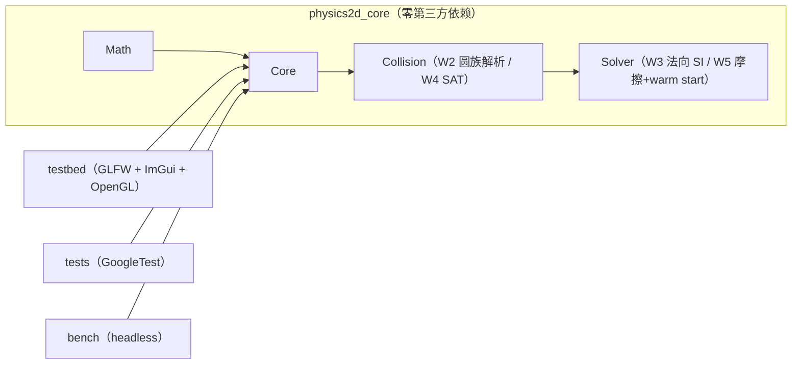

# Physics2D — 从零手写的 2D 刚体物理引擎

> 一个用于校招简历与面试深挖的 C++20 项目：完整走通
> **宽相 → 窄相 → 接触流形 → Sequential Impulse 求解 → 岛屿休眠** 的链路，
> 物理核心零第三方依赖、可 headless 回归、用 Tracy 量化每一阶段耗时。

**当前进度：Week 1-3 完成**（数学库/积分骨架/渲染循环 + 形状系统/解析碰撞/接触持久化 +
**法向 Sequential Impulse 求解器**；Week 4-8 的接口已预留）。详细计划见
[`docs/ROADMAP.md`](docs/ROADMAP.md)，接口预留清单见 [`docs/dev-interfaces.md`](docs/dev-interfaces.md)。

> 演示 GIF 将在对应 demo 落地后补上（Week 4+：10 方块堆叠 / 200 物体 SAP 对比 / 500 物体休眠）。

## ✨ 已实现（Week 1-3）

- **数学库**（`p2::Math`）：`Vec2`（三种 `Cross` 重载）、`Mat2`（列主序、求逆）、
  `Rot`（存 cos/sin 避免角度漂移）、`Transform`、`AABB`（fat AABB 语义）、`MathUtils`（FNV-1a）。
- **Core**（`p2::Core`）：`Body`/`BodyDef`/`BodyType`、generation 计的 `Handle` + `IDPool`、
  `World`（11 阶段 `Step` 流水线）、形状池（`Shape` + `ShapeHandle`）、接触列表、
  semi-implicit Euler 积分、单步位移钳制、`StepAccumulator` 固定步长、Debug `CheckSane`。
- **碰撞**（`p2::Collision`）：`CircleShape`（解析质量/惯性矩/AABB）、`PlaneShape`（无限半空间地面）、
  `CollideCircles` / `CollideCircleAndPlane` / `CollidePlaneAndCircle` / `FlipManifold`；
  相切=1 接触点且穿透恰为 0、同心圆确定性法线、法线 A→B、接触锚点双局部系反算；
  `Contact`/`ContactID` 帧间持久化（按 Key 继承每点冲量）。
- **求解器**（`p2::Solver`，Week 3）：法向 Sequential Impulse（PGS）——
  `K_n = invMassA + invMassB + invIA·Cross(rA,n)² + invIB·Cross(rB,n)²`、
  累计冲量非负钳制、`velocityIterations` 轮迭代、restitution 速度阈值 bias；
  每帧把累计冲量写回 `ContactPoint`（Week 5 warm start 的数据源）。
- **可交互测试台**：GLFW + OpenGL 3.3 Core + Dear ImGui(docking)，自写最小 GL loader、
  线框批处理渲染器、相机；两个 demo：`FallingBall`（平面落地 + restitution + 接触可视化）、
  `SphereStack`（3 球叠放）；`--demo <name>` / `--smoke N --hidden` 支持无人工干预验证。
- **工程质量**：CMake presets（Debug/Release/Sanitize/Headless + VS2022 兜底）、
  GoogleTest 单测（Eigen 交叉验证、debug death tests）、ASan/UBSan、GitHub Actions CI
  （双平台 + sanitize + headless + 分层守卫）。

## 🚀 快速开始（Windows）

```powershell
# 1) 一次性环境检查（VS2022 C++ 工作负载、CMake、Git、Ninja）
powershell -NoProfile -ExecutionPolicy Bypass -File scripts/bootstrap.ps1

# 2) 配置 + 编译 + 跑单测
powershell -NoProfile -ExecutionPolicy Bypass -File scripts/build.ps1 -Preset debug -RunTests

# 3) 启动测试台（可切换 FallingBall / SphereStack）
.\build\debug\testbed\physics2d_testbed.exe
```

Linux：

```bash
sudo apt install -y build-essential cmake ninja-build libgl1-mesa-dev xorg-dev
./scripts/build.sh debug --tests
```

> 依赖（GoogleTest/Eigen/GLFW/Dear ImGui）由 CMake `FetchContent` 在首次 configure 时拉取，
> 不需要 vcpkg。详见 [`docs/dev-setup.md`](docs/dev-setup.md)。

## 🏗️ 架构



- **分层铁律**：`physics2d_core` 不 include 任何渲染/UI 头（Tracy 例外），CI 有 grep 守卫；
  `World` 只前向声明 `ContactSolver`，Core 公共头不会把 Solver 拖进编译单元。
- 正式文档：[`docs/architecture.md`](docs/architecture.md)。

## 📁 目录

```text
include/physics2d/{Math,Core,Collision,Solver}/   # 公共头
src/{Math,Core,Collision,Solver}/                 # Week 1-3 实现（core 静态库）
testbed/                                          # 渲染 + ImGui 测试台 + demos
tests/unit/                                       # GoogleTest 单测；tests/regression/ 为 W6-7 预留
bench/                                            # headless 基准（W6 预留）
docs/                                             # 架构、接口预留清单、环境、开发日志、Roadmap
scripts/                                          # bootstrap / build / format / pre-commit
```

## 📊 测试与性能

- 单测：**210 个 ctest 用例**（Debug；Release 211，含 1 个 release-only skip 契约测试；
  其中 13 个 death test 在沙箱内自动 SKIP、CI 执行）。`debug` / `release` / `sanitize`（MSVC ASan）
  三套 preset 全绿（0 failed），MSVC `/W4 /permissive-` 项目代码零警告。
- 求解器实测：两球叠在地面的单次迭代残余法向速度 `g·dt/2 = 0.0833 m/s`，8 次迭代降到
  `0.00065 m/s`；静止穿透 **5.000 mm = `kLinearSlop`**；1:3 正碰动量误差 < 1e-4。
- Testbed 冒烟：
  - `--demo FallingBall --smoke 150 --hidden` → `contacts=1`，球停在 y=0.495（穿透 5.000 mm）；
  - `--demo SphereStack --smoke 300 --hidden` → `bodies=4 contacts=3`，3 球 y≈0.494/1.488/2.482，
    残余速度 ≤0.019 m/s（站立、允许小幅抖动）。
- 性能数据表（SAP vs BruteForce、warm starting、休眠）将在 Week 5-8 用实测数字填入
  `docs/profiling.md` 与 README —— 本仓库不写没有测量条件的数字。

## 🗺️ Roadmap

| 周 | 主题 | 状态 |
| --- | --- | --- |
| W1 | 数学库 + CMake + 渲染循环 + 积分骨架 | ✅ |
| W2 | 形状/平面/圆解析碰撞 + Contact 持久化 | ✅ |
| W3 | Sequential Impulse（法向）+ SphereStack | ✅ |
| W4 | SAT + 裁剪式 Manifold + 冷热数据拆分 | ⬜ |
| W5 | 摩擦/warm starting/split impulse + 参数面板 | ⬜ |
| W6 | Broad Phase（BruteForce + SAP）与量化 | ⬜ |
| W7 | 岛屿休眠 + demo 集 + headless 回归 | ⬜ |
| W8 | 文档/性能表/面试准备 | ⬜ |

完整验收标准见 [`docs/ROADMAP.md`](docs/ROADMAP.md)。

## ⚠️ 已知限制（Week 1-3）

- **求解器只有法向**：还没有摩擦、warm starting、split impulse（Week 5）；位置修正仍是
  Week 2 留下的简单推出（`TEMPORARY`），会向低速接触注入少量势能，长跑"完全静止"的断言
  只能写成契约。
- 碰撞形状只有圆与无限平面；多边形 SAT/裁剪在 Week 4。
- 宽相仍是 O(N²) + AABB 过滤（Week 6 换 SAP/BruteForce + 基准数据）。
- 叠放的 3 球会小幅抖动（300 帧残余速度 ≤0.019 m/s），符合 Week 3 D7 的预期；W5 后收敛更好。
- 只有 2 个 demo；demo 集在 Week 4-7 增加。
- `Body` 暂为单一结构（内含冷/热分区），Week 4 计划拆成 `BodySim`/`BodyState` 并行数组。
- 测试台需要可用的 OpenGL 上下文；无显示环境用 `--smoke`（验证初始化/循环与物理状态，不验证画面）。
- Tracy 剖析仅保留零成本钩子，正式接入在 Week 6-8。

## 📚 参考

Box2D（Erin Catto）、*Iterative Dynamics with Temporal Coherence* (GDC 2005)、
*Real-Time Collision Detection* (Christer Ericson)、Randy Gaul 的 impulse solver 系列文章。

## License

[MIT](LICENSE)
