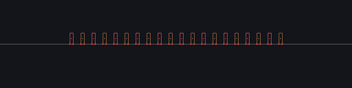
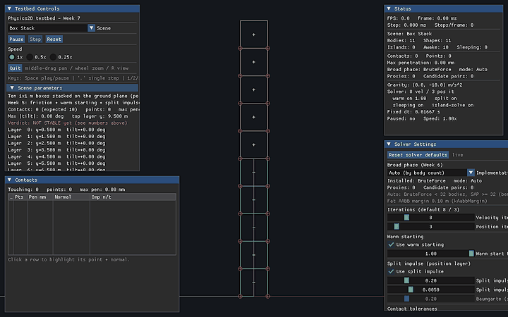
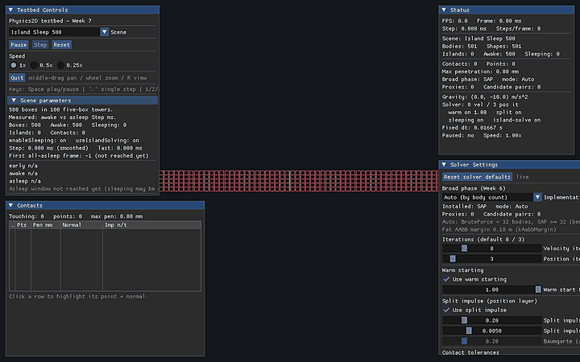
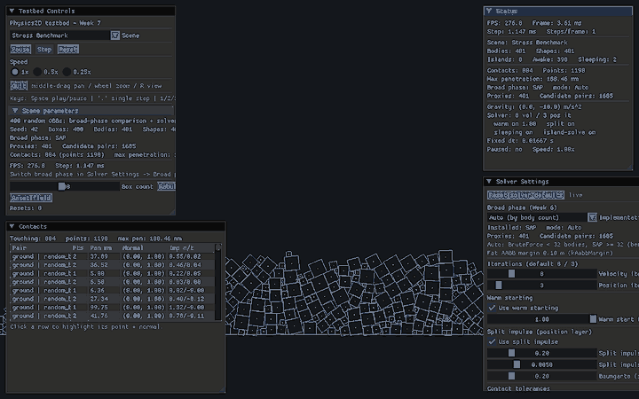
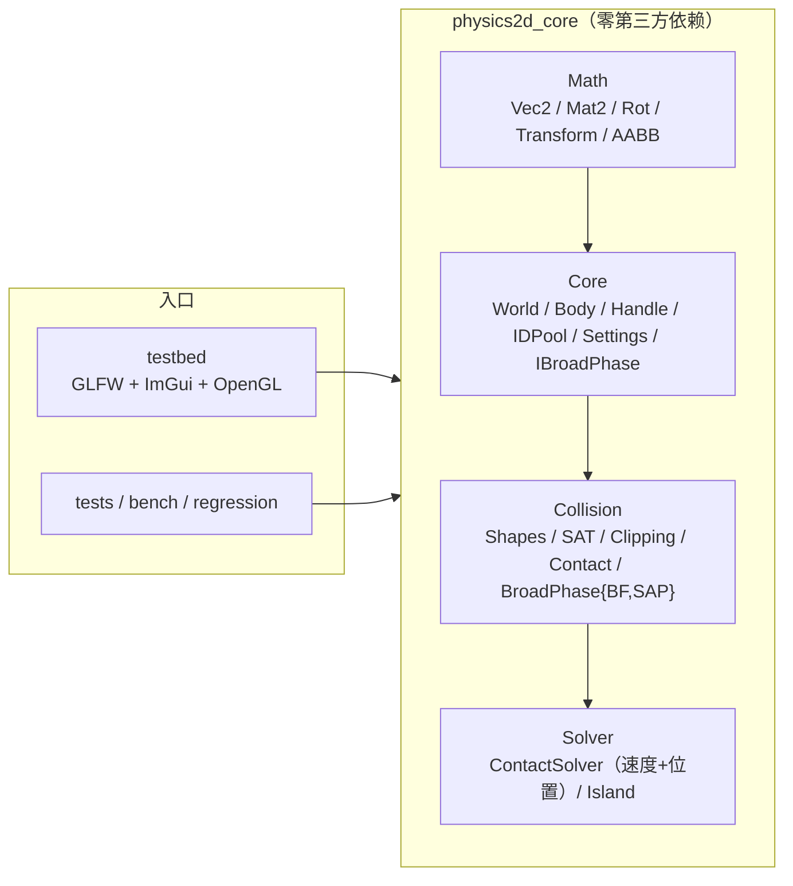

# Physics2D — 从零手写的 2D 刚体物理引擎

> English version: [README.en.md](README.en.md)

[](https://github.com/baisctong/Physics2D/actions/workflows/ci.yml)
[](https://github.com/baisctong/Physics2D/releases)

> 一个用于校招简历与面试深挖的 C++20 项目：从零实现
> **宽相 → 窄相 → 接触流形 → Sequential Impulse 求解 → 岛屿 / 休眠** 的完整物理链路，
> 物理核心零第三方依赖、可 headless 运行、有真实量化数据与确定性回归。

**v1.0-release（Week 1-8 全部完成）**：数学库、Body/World 积分骨架、形状系统 + 解析碰撞、
**凸多边形 SAT + 裁剪式 Manifold + SATCache**、**摩擦锥 + warm starting + split impulse**、
**10 方块堆叠 10 秒稳定**、**可插拔宽相（BruteForce + SAP，2000 物体 7.70x）**、
**岛屿分区 + 按岛求解（三模式逐位一致）+ 整岛原子休眠（500 物体休眠后 1.7x）**、
**headless 确定性回归（量化弱 hash）**、**8 个 demo 的交互式测试台**、
**边界契约测试**与完整文档（[`docs/`](docs/)）。

| 20 块多米诺连锁唤醒 | 10 盒塔 10 s 稳定 |
| --- | --- |
|  |  |
| **500 盒 / 100 岛整岛休眠（1.7x）** | **400 盒压力场景（SAP 宽相）** |
|  |  |

> 另有 [contact_debug.gif](docs/images/contact_debug.gif)：接触法线叠加 + 累计冲量/摩擦锥占用面板。
> GIF 由 testbed 的帧捕获模式（`--capture-dir`，Week 8 新增）确定性录制，一条命令可复现：
> `powershell -NoProfile -ExecutionPolicy Bypass -File scripts/record_gifs.ps1`。
> 录制参数、面板说明与 8 个 demo 的看点见 [`docs/demos.md`](docs/demos.md)。

## ✨ 特性

- **完整的物理链路，零第三方物理库**：`Math → Core → Collision → Solver` 四层，
  `physics2d_core` 只依赖 C++20 标准库，可 headless 编译/运行；分层规则由 CI 的 grep job 强制。
- **宽相**：`BroadPhaseBruteForce`（O(N²) 参考基线）+ `BroadPhaseSAP`（端点数组 + 帧间相干增量排序）；
  2000 物体、1000 帧 Release 实测 **7.70x**；**切换宽相物理结果逐位不变**。
- **窄相**：圆/平面解析路径 + **凸多边形 SAT**（reference/incident face + Sutherland–Hodgman 裁剪，
  面-面 2 接触点）+ 特征编码 `ContactID`（帧间稳定）+ `SATCache` 轴滞回。
- **Sequential Impulse 求解器**：累计冲量钳制、**库仑摩擦锥**、**warm starting**（完整继承，
  `warmStartFactor=1.0`）、**split impulse** 独立伪速度位置层（不向真实速度注入能量）、
  restitution 速度阈值、Baumgarte 对照基线。
- **稳定堆叠（里程碑）**：10×1 m 方块塔在默认 8 速度迭代 / 3 位置迭代下 600 步（10 s）稳定，
  最大穿透 **5.223 mm**（< 10 mm）、顶层 y 9.478 m、最大倾斜 0.0046 rad。
- **岛屿与休眠**：显式栈 DFS 接触图分区（规范序）、三种按岛求解模式（`flat` / **`grouped-direct` 默认**
  / `grouped-packed` opt-in）**逐位一致**、**整岛原子休眠/唤醒**（4 个外部入口 + 宽相邻近唤醒）、
  休眠岛跳过 AABB 更新/窄相/求解但保留 proxy 与上一帧 contact；500 盒静止后 Step **1.7x**。
- **工程与量化**：`physics2d_bench`（宽相 A/B，median + JSON）、`physics2d_regression`
  （量化弱 hash + golden + CTest + CI job）、GoogleTest（Eigen 交叉验证 + death tests）、
  ASan/UBSan、CMake presets（Debug/Release/Sanitize/Headless + VS2022 兜底）、
  GitHub Actions（Linux/Windows + sanitize + headless + regression + 分层守卫）。
- **交互式测试台**：GLFW + OpenGL 3.3 Core + Dear ImGui（docking），**8 个 demo**、实时调参、
  宽相切换、islands/awake/sleeping 状态、接触法线/穿透/**累计冲量柱状条与摩擦锥占用**、
  Space 暂停 / `.` 单步 / 1-2-3 慢放、帧捕获录制。

## 🚀 快速开始（陌生人 5 分钟）

前置：Windows 10/11 + **VS2022 C++ 工作负载** + CMake ≥ 3.25 + Git（Ninja 由脚本自动从 VS 安装目录查找）；
Linux 需要 g++/clang + cmake + ninja + X11/OpenGL 开发包。

```powershell
# 1) 一次性环境检查（VS2022 工作负载、CMake、Git、Ninja）
powershell -NoProfile -ExecutionPolicy Bypass -File scripts/bootstrap.ps1

# 2) 配置 + 编译 + 跑全部单测（首次会 FetchContent 下载 gtest/Eigen/GLFW/ImGui，1-2 分钟）
powershell -NoProfile -ExecutionPolicy Bypass -File scripts/build.ps1 -Preset debug -RunTests

# 3) 启动测试台：下拉框切换 8 个 demo（Space 暂停 / '.' 单步 / 1-2-3 慢放 / R 回默认视野）
.\build\debug\testbed\physics2d_testbed.exe
```

Linux：

```bash
sudo apt install -y build-essential cmake ninja-build libgl1-mesa-dev xorg-dev
./scripts/build.sh debug --tests
```

> 依赖（GoogleTest / Eigen / GLFW / Dear ImGui）由 CMake `FetchContent` 在首次 configure 时拉取，
> **不使用 vcpkg**。细节见 [`docs/dev-setup.md`](docs/dev-setup.md)。
> 只想确认"项目是活的"、要手动验收、或想跑 bench/回归/death tests：见
> [`docs/testing.md`](docs/testing.md)（30 秒版 / 全量验收 / 10 分钟人工验收脚本 / FAQ）。

## 🏗️ 架构



**`World::Step` 的 11 阶段流水线（顺序不可变）**：

```text
1 IntegrateForces → 2 UpdateBroadPhase → 3 UpdateContacts（窄相 + proximity wake）
→ 4 BuildIslands → 4b PrepareConstraints → 5 WarmStart → 6 SolveVelocity ×N
→ 7 IntegratePositions → 8 SolvePosition ×M（split impulse）→ 9 Synchronize
→ 10 UpdateSleep（整岛原子）→ 11 Validate（NaN/Inf）
```

- **分层铁律**：`physics2d_core` 不 include 任何渲染/UI 头（Tracy 例外，零成本宏），CI 有 grep 守卫；
  `World` 只前向声明 `ContactSolver`，Core 公共头不会把 Solver 拖进编译单元。
- **确定性**：固定 dt（1/60，accumulator 是唯一时间转换点）、迭代顺序由 vector 下标决定、
  候选对规范化为 `(i<j, sorted, deduped)`、岛屿分区为规范序；不使用 `unordered_map` 遍历顺序。
- 一张图讲清模块依赖 + Step 时序 + 岛屿/休眠状态机 + 数据所有权：见
  [`docs/architecture.md`](docs/architecture.md)（含 6 张 Mermaid 图）。

## 📐 核心算法（完整推导见 [`docs/math.md`](docs/math.md)）

**SAT（2D）**：两个凸多边形只需检查各自的边法线轴（2D 不需要 3D 的叉积轴）。对每条边取外法线
`n` 投影两个多边形，取分离最大 / 穿透最小的轴作为法线（严格 A→B）；该轴所属面是 **reference face**，
另一多边形上法线最反向的边是 **incident face**；用 `ClipSegmentToLine` 做侧向裁剪 + 参考面裁剪，
得到 0–2 个接触点。`ContactID = referenceEdge | incidentVertex<<4 | type<<8`（不含 flip，
A/B 交换后 Key 不变 = warm start 跨帧匹配的前提）。

**约束冲量（有效质量）**：接触点相对速度 `vRel = (vB + ωB×rB) − (vA + ωA×rA)`，法向分量 `vn = vRel·n`。
施加冲量 `λ` 后 `Δvn = λ·K_n`，其中

```text
K_n = 1/mA + 1/mB + (rA×n)²/IA + (rB×n)²/IB        （切向 K_t 把 n 换成 t = Skew(n)）
λ   = −vn / K_n                                       （累计钳制 accN = max(accN+λ, 0)）
```

**摩擦锥**：切向冲量按库仑锥钳制**累计值**（不是增量）：`accT = Clamp(accT+λt, −μ·accN_new, +μ·accN_new)`，
先解法向再解切向（摩擦锥半径用更新后的 `accN`），`μ = sqrt(μA·μB)` 由 World 在接触上组合一次。

**Warm starting**：`ContactPoint` 的累计冲量按 `ContactID::Key()` 跨帧继承，`Prepare` 播种
（`acc = inherited × warmStartFactor`，默认 1.0），`WarmStart` 只施加一次。实测 factor < 1 会每帧
丢掉已收敛解、重新注入 PGS 顺序偏差：10 盒塔 600 步下 0.85→259 步塌、1.0→不塌。

**Split impulse（位置层）**：位置修正不污染真实速度——用独立伪速度层在 `IntegratePositions` 之后
按新 transform 重算杠杆臂，`target = (β/dt)·max(0, penetration − slop)`，迭代后只积分伪速度并清零。
静置 **0.10 m 深穿透**箱实测：split impulse 真实速度注入 **0.000000 m/s** vs Baumgarte **1.139999 m/s**
（2 cm 浅重叠场景的 Baumgarte 目标是 0.18 m/s，在 `test_solver_split_impulse` 中单独断言）。

**岛屿与休眠**：只有 dynamic-dynamic contact 是岛图的边（static/kinematic 是边界，否则共享地面会把
所有堆叠合并成一个岛）。显式栈 DFS 求连通分量 + 规范序；**整岛原子**休眠（岛内全部满足
`|v| < 0.01 m/s`、`|ω| < 阈值` 连续 0.5 s 才整岛入睡），休眠岛零工作但保留 proxy/接触，
唤醒必须整岛（外部力/冲量/transform 或宽相邻近重叠）。

## 📊 性能（真实 Release 实测；完整表与测量条件见 [`docs/profiling.md`](docs/profiling.md)）

**测量环境**：Windows 11 22631 / Intel i7-12650H / 16 GB / RTX 4060 / MSVC 19.44（`/W4 /permissive-`）
/ CMake 3.31.12 / Ninja 1.12.1 / **RelWithDebInfo**（Release preset）。bench 固定 seed 42，
前 100 帧预热丢弃，取 median；本机噪声 ±2–5%。

**宽相 A/B（`physics2d_bench`，N 个随机盒、1000 帧；只计 `UpdateAABB + QueryPairs`）**：

| Bodies | BruteForce ms/帧 | SAP ms/帧 | 加速比 | 候选对/帧 | 真实重叠/帧 |
| ---: | ---: | ---: | ---: | ---: | ---: |
| 50 | 0.0034 | 0.0016 | 2.12x | 3.4 | 1.8 |
| 200 | 0.0839 | 0.0173 | 4.88x | 55.3 | 31.3 |
| 500 | 0.5466 | 0.0931 | 5.92x | 354.3 | 202.5 |
| 2000 | 9.3061 | 1.2084 | **7.70x** | 5670.6 | 3206.6 |

小 N 反转（SAP 端点维护开销）：N=5 0.00x / 10 0.50x / 20 1.00x / 50 2.00x；交叉点细化后
**N≈24–26**（W6 初始记录 N≈25–32，量级一致），testbed 的 Auto 阈值保守取 32。
**每个数字都能用一条命令复现**（见 profiling.md）。

**岛屿休眠（IslandSleep500：500 盒 = 100 座 5 层塔，Release 600 步）**：

| 阶段 | 平均 Step 耗时 | 相对 |
| --- | ---: | ---: |
| 永不休眠（sleeping off 稳态对照，Release gtest） | 0.5557 ms | 1.00x |
| 全休眠（frame 105 / 1.75 s 起，Release gtest） | 0.2772 ms | **≈2.00x** |
| testbed「awake 窗口」（混合统计窗，端到端 canonical） | 0.4634 → 0.2656 ms | **1.74x** |

debug 同场景 4.95 → 2.94 ms（1.69x）；10 盒塔 debug 3.30x（87.5 → 26.5 µs/step，sleep step 859，
W7 历史同机实测）。休眠后仍保留宽相 sweep 与接触复用，因此加速不是数量级。**两个口径都真实**：
1.70–1.74x 是 testbed 的 awake 窗口口径（W8 两次测量会话，对外引用），≈2.0x 是"全醒 vs 全睡"纯口径（见 profiling §3.2 / §1.5）。

**按岛求解三模式（400 bodies / 760 contacts 单岛，40 reps，8 迭代）**：flat 1.860 ms /
`grouped-direct`（默认）1.908 ms（0.97x，噪声内）/ `grouped-packed`（opt-in）2.137 ms
（**0.87x，比 flat 慢约 15%**）；32 迭代 7.056 / 7.570（0.93x）/ 7.928（0.89x）。
结论：该规模下整个 Body 数组（≈80 KB）本就装得进 L2，每帧打包拷贝的成本大于局部性收益，
所以 packed 默认关闭；岛屿的真正收益是休眠跳过与多岛剔除（上表 1.74x）。

**构建/测试耗时（canonical clean 配置+构建+ctest，含 FetchContent 下载）**：debug **50.1 s** /
release **53.6 s** / sanitize(ASan) **86.0 s**。测试规模与三 preset 结果见下节。

## 🎮 Demos（8 个；操作/面板/录制说明见 [`docs/demos.md`](docs/demos.md)）

| Demo | 内容 | 看点 |
| --- | --- | --- |
| `FallingBall` | 球落地 + 重力/材质滑条 | 穿透 5 mm、restitution 阈值 |
| `SphereStack` | 3 球叠放 | 逐渐入睡（sleeping=3） |
| `BoxStack` | **10 层方块塔** | 10 s 稳定；可扔球撞塔 / 重置；3 迭代会明显变软 |
| `FrictionRamp` | 斜面 μ vs tanθ | 15° 时 μ=0.30 > tanθ 静止，μ=0.1 下滑 |
| `Pyramid200` | 完美盒金字塔（4–24 层可调，默认 16 层=136 盒） | 载荷/迭代预算与底部穿透 |
| `StressBenchmark` | 400 随机盒压力场 | 宽相 candidates/proxies、SAP 路径 |
| `Dominoes` | 20 块骨牌 | 睡眠后推第一块 → **20/20 连锁唤醒无跳过** |
| `IslandSleep500` | 500 盒 / 100 岛 | awake 500→0、休眠前后 Step 耗时对比 |

面板：Solver 参数滑条（迭代/warmFactor/split impulse/摩擦/restitution/重力…）、Broad phase 下拉
（Auto/None/BruteForce/SAP）、Status（Step 耗时/FPS/islands/awake/sleeping）、Contacts 调试
（法线/穿透/累计冲量柱状条 + 摩擦锥占用，点击高亮）。键位：`Space` 暂停、`.` 单步、`1/2/3` 慢放、
鼠标中键拖拽平移、滚轮缩放、`R` 回默认视野。

## 🧪 测试与确定性回归

- **测试规模（v1.0 终版源码）**：debug/sanitize **387 个 ctest 用例**、release **390**
  （多 3 个 release-only 契约测试）；= 386 个 gtest 用例（其中 31 个 death test 在沙箱内自动 SKIP、
  CI 执行）+ 1 个 `regression_default` 回归用例。三 preset 全绿、MSVC `/W4 /permissive-`
  **0 项目警告**。测试 exe 复制到工作区外运行 → **386/386 gtest 全过**（31 个 death test 真正执行）。
- **确定性回归**：`physics2d_regression` 重放固定 600 步场景，量化弱 hash（quantum 1e-5）
  **`588d30e70f9b4ddd`** 与 golden 一致（CTest `regression_default` + CI job）；退出码 0 匹配 /
  1 不匹配 / 2 用法或 IO 错误。纯重构（宽相切换、岛屿分组）hash 必须不变。
- **等价性证据（优化不改物理）**：
  - 同一场景 无宽相 / BruteForce / SAP 300 步**逐帧 545 floats 逐位一致**（body 状态 + 接触列表含累计冲量）；
    运行中切换宽相 150 步与参照 World 逐位一致；
  - SAP vs BruteForce 10 组随机场景（N=50/200/500）× 1000 帧 = 10,000 帧配对集合完全一致
    （677,584 对比较 0 mismatch）；
  - flat / grouped-direct / grouped-packed 三求解模式：两岛 276 次 + 密集单岛 21,760 次 float 比较
    **0 差异**；World 级 300 步 × 469 floats/步逐位一致；
  - testbed `--broadphase none|bf|sap` 的 body/contact 输出行 **SHA-256 相同**。
- **边界契约**：退化多边形/零密度/非有限输入/极大速度/超长薄条/极端 mass ratio/非法 World 生命周期
  等全部有 assert 或明确文档；见 [`docs/boundary-contracts.md`](docs/boundary-contracts.md)
  与对应 `tests/unit/test_boundary_*.cpp`。

## 📁 目录

```text
include/physics2d/{Math,Core,Collision,Solver}/   # 公共头（冻结 API）
src/{Math,Core,Collision,Solver}/                 # core 静态库实现
testbed/                                          # GLFW + ImGui 测试台 + 8 demos + SceneBuilders
tests/unit/                                       # GoogleTest 单测（含边界契约测试）
tests/regression/                                 # headless 确定性回归 + golden
bench/                                            # headless 宽相基准
docs/                                             # 架构/数学/性能/边界/演示/测试/环境/devlog
scripts/                                          # bootstrap / build / format / record_gifs
```

## 📚 文档地图

| 文档 | 内容 |
| --- | --- |
| [`docs/architecture.md`](docs/architecture.md) | 模块依赖、数据布局、Step 11 阶段时序、岛屿/休眠状态机、宽相/窄相/求解数据流（含 Mermaid 总图） |
| [`docs/math.md`](docs/math.md) | SAT/冲量/摩擦锥/warm starting/split impulse/岛屿休眠的完整推导 + 面试追问 |
| [`docs/profiling.md`](docs/profiling.md) | 全部实测性能表（宽相/休眠/三求解模式/构建耗时）+ 测量环境与纪律 |
| [`docs/boundary-contracts.md`](docs/boundary-contracts.md) | 边界场景的契约表（assert/返回值/文档化限制）与已知限制 |
| [`docs/demos.md`](docs/demos.md) | 8 个 demo 说明、操作键、Panel 说明、GIF 录制命令 |
| [`docs/testing.md`](docs/testing.md) | 手动测试指南：30 秒版 / 全量验收 / 10 分钟人工验收脚本 / smoke / bench / 回归 / death tests |
| [`docs/devlog.md`](docs/devlog.md) | 每周周报（完成/卡住/数据/下周/提醒）——面试素材来源 |
| [`docs/dev-interfaces.md`](docs/dev-interfaces.md) | 18 条预留接口状态、偏差登记、不可破坏的不变量 |
| [`docs/ROADMAP.md`](docs/ROADMAP.md) | 8 周计划与每周验收记录 |
| [`docs/resume-interview.md`](docs/resume-interview.md) | 简历 bullet（带实测数字）、25 问面试库、20 分钟讲解脚本 |
| [`docs/release-notes-v1.0.md`](docs/release-notes-v1.0.md) | v1.0-release 发布说明（亮点/边界/验证清单） |
| [`README.en.md`](README.en.md) | English version of this README |
| [`HANDOFF.md`](HANDOFF.md) | 换会话交接：现状、验证基线、红线与坑 |

## ⚠️ 已知限制（v1.0，诚实清单）

- **30:1 单列高塔在默认 8 速度迭代下会塌**：PGS 每帧要沿 30 层传递支撑，8 次迭代的传播预算不足
  （10 盒是 8 迭代的验收场景；30 盒需要 ~32 次速度迭代才能站住）。同理，**金字塔底部承载 16+ 个盒
  时会有超出 10 mm 的稳态穿透**（载荷/迭代预算属性，不是 bug）：Pyramid200 默认 16 层 136 盒实测
  29.7 mm / 1.36°；20 层 210 盒 100.5 mm / 6.02°。
- **入睡速度受残余抖动限制**：10 盒塔需要 ~859 步（14.3 s）才满足 0.5 s 连续安静窗；更薄的立牌
  （<0.2 m）在当前逐点 PGS 下几乎无法入睡。根因是 2 点接触逐点求解的顺序偏差，正解是
  **2 点接触 2×2 block solver**（列入 v1.1 最高优先级技术债）；本仓库没有为了数字好看而调大
  `kSleepLinearTolerance`（保持设计值 0.01）。
- **`Body` 仍为单一结构**（内含冷/热分区 + W5-W7 追加的热字段）：`BodySim`/`BodyState` 拆分在
  W4→W8 连续顺延后决定不做——W7 首次实测"岛内打包"在 400 体规模反而更慢，W8 复测为 0.87x
（比 flat 慢约 15%），profiling 也没有证据
  表明 body 布局是热点；列为 v1.1 候选（先有 Tracy 数据再做）。
- **按岛求解的 body 打包默认关闭**（`packIslandBodies=false`）：Release 实测 0.87x（见上），
  保留为 opt-in 并被位级测试覆盖。
- **形状与 CCD**：碰撞形状只有凸多边形（≤8 顶点）/ 圆 / 无限平面；不支持凹多边形（需自行拆分）、
  Capsule、**CCD/TOI**（高速小球可能隧穿；单步位移有 `kMaxTranslation` 钳制但不是连续碰撞检测）。
- **没有关节系统 / 多线程**：关节（revolute/prismatic/…）与岛屿级并行都未实现（岛屿天然独立，
  per-island 并行是 v1.1 的起点）。
- **Tracy 只保留零成本钩子**（`Core/Profiler.h` + CMake 选项），正式接入推迟到 v1.1；
  v1.0 的性能数据来自 `physics2d_bench` 与 testbed Status 面板。
- **渲染插值未实现**（`StepAccumulator::GetAlpha()` 已预留）：慢放/单步可用，但高刷新率下运动
  仍是"每物理步更新一次"。
- **测试台需要可用的 OpenGL 3.3 上下文**（远程桌面/无 GPU 环境不可用）；无显示环境用 `--smoke`。
- **确定性范围**：同平台同编译器逐位一致；跨平台靠量化弱 hash（1e-5）判定，不保证 bit-exact。
- **本机增量构建不可信（环境问题，不是引擎问题）**：中文 locale MSVC 的 `/showIncludes` 让 Ninja
  记录不到头文件依赖，可能因类布局不一致触发 HEAP CORRUPTION；`scripts/build.ps1` 已自动检测
  header 比 obj 新并强制 clean-first（详见 [`docs/dev-setup.md`](docs/dev-setup.md) §6）。

## 🗺️ Roadmap

**v1.0-release 已完成（Week 1-8）**：

| 周 | 主题 | 状态 |
| --- | --- | --- |
| W1 | 数学库 + CMake + 渲染循环 + 积分骨架 | ✅ |
| W2 | 形状/平面/圆解析碰撞 + Contact 持久化 | ✅ |
| W3 | Sequential Impulse（法向）+ SphereStack | ✅ |
| W4 | SAT + 裁剪式 Manifold + SATCache + BoxStack 初版 | ✅ |
| W5 | 摩擦/warm starting/split impulse + **10 方块堆叠 10 s 稳定** | ✅ |
| W6 | BruteForce + SAP + **2000 物体 7.70x** + bench + headless 回归 | ✅ |
| W7 | 岛屿分区/按岛求解 + **整岛休眠（1.7x）** + Dominoes/IslandSleep500 | ✅ |
| W8 | 架构图/math/profiling/README+GIF/边界契约/简历面试 + **v1.0-release** | ✅ |

**v1.1+（按优先级）**：

1. **2 点接触 2×2 block solver**（最高优先级技术债）：消除薄片/2 点接触的残余抖动 → 更快入睡；
   预期会改变回归 hash，需记录 old/new 与原因。
2. **Tracy 正式接入**（R11）：8 个 Step 阶段 + SAP 排序/扫描埋点与 `Plot(awake/contacts)`。
3. **渲染插值**（R17）：用 accumulator alpha 在两步之间插值渲染。
4. **`BodySim`/`BodyState` 冷热拆分**（R15）：先有 Tracy 数据证明 body 布局是热点。
5. **多场景回归 golden**（R12 扩展）：`--frames` 模板化，覆盖 Pyramid200 / 休眠场景。
6. **岛屿级并行**（多线程求解天然独立岛）与 **DynamicAABBTree**（可选宽相第三实现）。

## 📚 参考

Box2D（Erin Catto）、*Iterative Dynamics with Temporal Coherence*（GDC 2005）、
*Real-Time Collision Detection*（Christer Ericson）、Randy Gaul 的 impulse solver 系列文章。

## License

[MIT](LICENSE)
