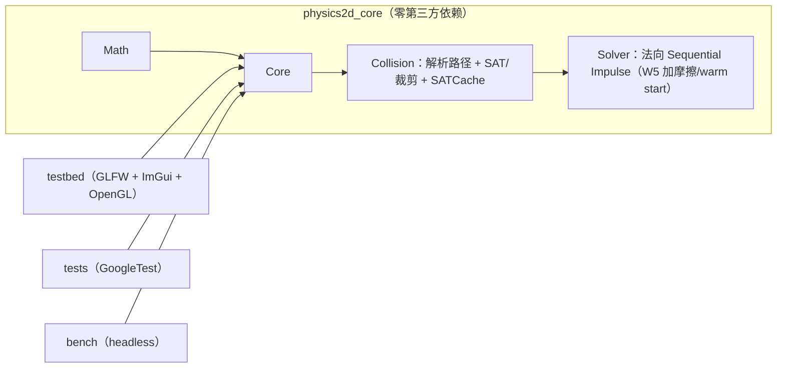

# Physics2D — 从零手写的 2D 刚体物理引擎

> 一个用于校招简历与面试深挖的 C++20 项目：完整走通
> **宽相 → 窄相 → 接触流形 → Sequential Impulse 求解 → 岛屿休眠** 的链路，
> 物理核心零第三方依赖、可 headless 回归、用 Tracy 量化每一阶段耗时。

**当前进度：Week 1-4 完成**（数学库/积分骨架/渲染循环 + 形状系统与解析碰撞 +
**凸多边形 SAT + 裁剪式 Manifold + SATCache** + 法向 Sequential Impulse 求解器；
Week 5-8 的接口已预留）。详细计划见 [`docs/ROADMAP.md`](docs/ROADMAP.md)，
接口预留清单见 [`docs/dev-interfaces.md`](docs/dev-interfaces.md)。
**换会话/接手开发先读 [`HANDOFF.md`](HANDOFF.md)**（现状、验证基线、Week 5 任务卡、红线与坑）。

> 演示 GIF 将在稳定堆叠（Week 5）后录制：10 方块堆叠 / 200 物体 SAP 对比 / 500 物体休眠。

## ✨ 已实现（Week 1-4）

- **数学库**（`p2::Math`）：`Vec2`（三种 `Cross` 重载）、`Mat2`、`Rot`（c/s 存储）、`Transform`、
  `AABB`（fat AABB 语义）、`MathUtils`（FNV-1a）。
- **Core**（`p2::Core`）：`Body`/`BodyDef`/`BodyType`、generation 计的 `Handle`+`IDPool`、
  11 阶段 `Step` 流水线、形状池（Circle/Plane/**Polygon**）、接触列表、固定步长 `StepAccumulator`、
  semi-implicit Euler、单步位移钳制、Debug `CheckSane`。
- **碰撞**（`p2::Collision`）：
  - 解析路径：圆-圆、圆-平面、**圆-多边形（Voronoi 最近特征）**、**多边形-平面（2 点支撑）**；
  - **凸多边形 SAT**：`FindMaxSeparation`、reference/incident face、Sutherland–Hodgman 式
    `ClipSegmentToLine`、面-面 2 点 / 顶点-面 1 点、A/B 交换对称；
  - **ContactID** 特征编码（`Key()` 与朝向无关，帧间稳定）；**SATCache** 轴滞回
    （近轴平局沿用上一帧 reference，`useSatCache` 可关）；`PolygonShape` 严格校验 + 质量积分。
- **求解器**（`p2::Solver`）：法向 Sequential Impulse（`K_n`、累计钳制、迭代、restitution 速度阈值）。
- **可交互测试台**：GLFW + OpenGL 3.3 Core + Dear ImGui，三个 demo：
  `FallingBall`（落地+restitution+接触可视化）、`SphereStack`（3 球叠放）、
  `BoxStack`（10 层方块塔，Week 4 初版：**无摩擦/无 warm start，塔会塌**——这是 W5 稳定堆叠的
  before 基线）。`--demo <name>` / `--smoke N --hidden` 支持自动化验证。
- **工程质量**：CMake presets（Debug/Release/Sanitize/Headless + VS2022 兜底）、GoogleTest
  （Eigen 交叉验证 + debug death tests）、ASan/UBSan、GitHub Actions CI（双平台+sanitize+headless+分层守卫）。

## 🚀 快速开始（Windows）

```powershell
# 1) 一次性环境检查（VS2022 C++ 工作负载、CMake、Git、Ninja）
powershell -NoProfile -ExecutionPolicy Bypass -File scripts/bootstrap.ps1

# 2) 配置 + 编译 + 跑单测
powershell -NoProfile -ExecutionPolicy Bypass -File scripts/build.ps1 -Preset debug -RunTests

# 3) 启动测试台（下拉框切换 FallingBall / SphereStack / BoxStack）
.\build\debug\testbed\physics2d_testbed.exe
```

Linux：

```bash
sudo apt install -y build-essential cmake ninja-build libgl1-mesa-dev xorg-dev
./scripts/build.sh debug --tests
```

> 依赖（GoogleTest/Eigen/GLFW/Dear ImGui）由 CMake `FetchContent` 在首次 configure 时拉取，
> 不需要 vcpkg。详见 [`docs/dev-setup.md`](docs/dev-setup.md)。

## 🏗️ 架构



- **分层铁律**：`physics2d_core` 不 include 任何渲染/UI 头（Tracy 例外），CI 有 grep 守卫；
  `World` 只前向声明 `ContactSolver`，Core 公共头不会把 Solver 拖进编译单元。
- 正式文档：[`docs/architecture.md`](docs/architecture.md)。

## 📁 目录

```text
include/physics2d/{Math,Core,Collision,Solver}/   # 公共头
src/{Math,Core,Collision,Solver}/                 # Week 1-4 实现（core 静态库）
testbed/                                          # 渲染 + ImGui 测试台 + demos
tests/unit/                                       # GoogleTest 单测；tests/regression/ 为 W6-7 预留
bench/                                            # headless 基准（W6 预留）
docs/                                             # 架构、接口预留清单、环境、开发日志、Roadmap
scripts/                                          # bootstrap / build / format / pre-commit
```

## 📊 测试与性能

- 单测：**278 个 ctest 用例**（Release 279，含 1 个 release-only 契约测试；其中 15 个 death test
  在沙箱内自动 SKIP、CI 执行）。`debug` / `release` / `sanitize`（MSVC ASan）三套 preset 全绿，
  MSVC `/W4 /permissive-` 项目代码零警告。clean 配置+构建+ctest：debug 52.0s / release 41.5s /
  sanitize(ASan) 38.5s（i7-12650H，含依赖编译）。
- 关键实测（详细条件见 `docs/devlog.md`）：
  - 盒-地面：**2 个接触点**、normal=(0,1)、穿透 5.000mm = `kLinearSlop`；
  - ContactID 稳定性：方块 0°→90°（0.5° 步长、181 帧）Key 集合只变 **2 次**（1.0°/89.5°）；
  - SAT cache：双盒 @20 迭代 300 步，Key churn **4 vs 264**（on/off），穿透 0.00280 vs 0.00333m；
  - 双盒堆 @40 迭代 600 步 gap=**1.0000**、x≈0（solver 有能力，W5 warm start 后默认 8 迭代即可）；
  - BoxStack W4 基线：10 盒 @默认 8 迭代 collapse step≈138、run 内最大穿透 0.1413m
    （无摩擦 + 无 warm start 时多层堆叠物理上不稳定，W5 修复）。
- Testbed smoke：
  - `--demo FallingBall --smoke 150 --hidden` → `contacts=1`，球停在 y=0.495（穿透 5.000mm）；
  - `--demo SphereStack --smoke 300 --hidden` → `bodies=4 contacts=3`，3 球站立；
  - `--demo BoxStack --smoke 300 --hidden` → `bodies=11 contacts=10`，塔塌（W4 预期）。
- 性能数据表（SAP vs BruteForce、warm starting、休眠）将在 Week 5-8 用实测数字填入
  `docs/profiling.md` 与 README —— 本仓库不写没有测量条件的数字。

## 🗺️ Roadmap

| 周 | 主题 | 状态 |
| --- | --- | --- |
| W1 | 数学库 + CMake + 渲染循环 + 积分骨架 | ✅ |
| W2 | 形状/平面/圆解析碰撞 + Contact 持久化 | ✅ |
| W3 | Sequential Impulse（法向）+ SphereStack | ✅ |
| W4 | SAT + 裁剪式 Manifold + SATCache + BoxStack 初版 | ✅ |
| W5 | 摩擦/warm starting/split impulse + 稳定堆叠里程碑 | ⬜ |
| W6 | Broad Phase（BruteForce + SAP）与量化 | ⬜ |
| W7 | 岛屿休眠 + demo 集 + headless 回归 | ⬜ |
| W8 | 文档/性能表/面试准备 | ⬜ |

完整验收标准见 [`docs/ROADMAP.md`](docs/ROADMAP.md)。

## ⚠️ 已知限制（Week 1-4）

- **求解器只有法向**：还没有摩擦、warm starting、split impulse（Week 5）。因此**无摩擦的多层
  堆叠在物理上不稳定**，BoxStack demo 在 W4 会塌（这是预期基线，不是 bug）。
- 位置修正仍是 Week 2 留下的简单推出（`TEMPORARY`），W5 换 split impulse；低速接触会长跑不静止。
- 宽相仍是 O(N²) + AABB 过滤（Week 6 换 SAP/BruteForce + 基准数据）。
- `Body` 暂为单一结构（内含冷/热分区），冷热拆分计划在 W5 末（原 W4，见偏差登记）。
- 碰撞形状只有凸多边形（≤8 顶点）/圆/无限平面；不支持凹多边形（需拆分）、CCD。
- 测试台需要可用的 OpenGL 上下文；无显示环境用 `--smoke`。
- Tracy 剖析仅保留零成本钩子，正式接入在 Week 6-8。

## 📚 参考

Box2D（Erin Catto）、*Iterative Dynamics with Temporal Coherence* (GDC 2005)、
*Real-Time Collision Detection* (Christer Ericson)、Randy Gaul 的 impulse solver 系列文章。

## License

[MIT](LICENSE)
