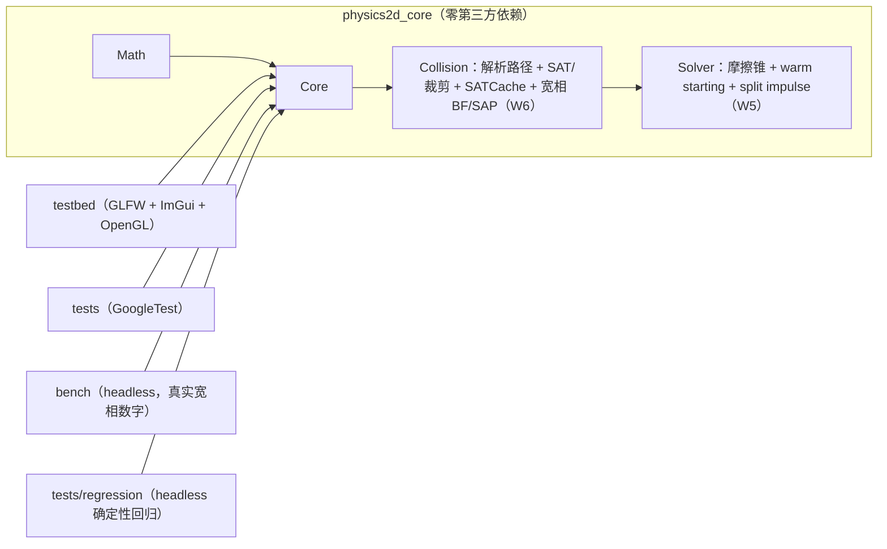

# Physics2D — 从零手写的 2D 刚体物理引擎

> 一个用于校招简历与面试深挖的 C++20 项目：完整走通
> **宽相 → 窄相 → 接触流形 → Sequential Impulse 求解 → 岛屿休眠** 的链路，
> 物理核心零第三方依赖、可 headless 回归、用 Tracy 量化每一阶段耗时。

**当前进度：Week 1-6 完成**（数学库/积分骨架/渲染循环 + 形状系统与解析碰撞 +
**凸多边形 SAT + 裁剪式 Manifold + SATCache** + **摩擦锥/warm starting/split impulse 求解器** +
**10 方块堆叠 10 秒稳定里程碑** + **可插拔宽相（BruteForce + SAP，2000 物体 7.8x 加速）** +
**headless 确定性回归**；Week 7-8 的接口已预留）。详细计划见
[`docs/ROADMAP.md`](docs/ROADMAP.md)，接口预留清单见 [`docs/dev-interfaces.md`](docs/dev-interfaces.md)。
**换会话/接手开发先读 [`HANDOFF.md`](HANDOFF.md)**（现状、验证基线、下一周任务卡、红线与坑）。

> 演示 GIF 将在后续周录制：10 方块稳定堆叠（已达成）/ 200 物体 SAP 对比（数据已达成）/ 500 物体休眠。

## ✨ 已实现（Week 1-6）

- **数学库**（`p2::Math`）：`Vec2`（三种 `Cross` 重载）、`Mat2`、`Rot`（c/s 存储）、`Transform`、
  `AABB`（fat AABB 语义）、`MathUtils`（FNV-1a + 量化弱 hash）。
- **Core**（`p2::Core`）：`Body`/`BodyDef`/`BodyType`、generation 计的 `Handle`+`IDPool`、
  11 阶段 `Step` 流水线、形状池（Circle/Plane/**Polygon**）、接触列表、固定步长 `StepAccumulator`、
  semi-implicit Euler、单步位移钳制、可插拔 `IBroadPhase`、Debug `CheckSane`。
- **碰撞**（`p2::Collision`）：
  - 解析路径：圆-圆、圆-平面、**圆-多边形（Voronoi 最近特征）**、**多边形-平面（2 点支撑）**；
  - **凸多边形 SAT**：`FindMaxSeparation`、reference/incident face、Sutherland–Hodgman 式
    `ClipSegmentToLine`、面-面 2 点 / 顶点-面 1 点、A/B 交换对称；
  - **ContactID** 特征编码（`Key()` 与朝向无关，帧间稳定）；**SATCache** 轴滞回
    （近轴平局沿用上一帧 reference，`useSatCache` 可关）；`PolygonShape` 严格校验 + 质量积分；
  - **宽相**（Week 6）：`BroadPhaseBruteForce`（O(N²) 参考基线）与 **`BroadPhaseSAP`**
    （单 vector 端点数组 + 首帧 `std::sort` / 稳态冒泡增量排序 + 有序 active 集合 + y 轴二次过滤，
    `ValidateInternalState` 可验内部不变量）；World 侧 fat AABB（+0.1m margin）、proxy 生命周期管理、
    候选对规范化为 (i<j, sorted, deduped) → **切换宽相不改变物理结果（逐位一致）**。
- **求解器**（`p2::Solver`，Week 5 完整）：
  - **摩擦**：`t = Skew(n)`、`K_t`、**累计**切向冲量钳制 `accT ∈ [−μ·accN, +μ·accN]`（摩擦锥），
    法向先解、切向后解；
  - **Warm starting**：`ContactPoint` 累计冲量按 `ContactID::Key()` 跨帧继承，`Prepare` 播种、
    `WarmStart` 施加一次（默认 `warmStartFactor = 1.0`，Box2D 同款）；
  - **Split impulse**：独立伪速度位置层清理穿透，**不向真实速度注入能量**（W2 的临时位置推出已删除）；
  - restitution 速度阈值、Baumgarte 对比基线（`useSplitImpulse=false` 时）、`SolverSettings` 全参数运行时生效。
- **可交互测试台**：GLFW + OpenGL 3.3 Core + Dear ImGui，6 个 demo：
  `FallingBall`（落地+restitution+接触可视化）、`SphereStack`（3 球叠放）、
  `BoxStack`（10 层方块塔，**Week 5 起 10 s 稳定**，最大穿透 3.9 mm）、
  `FrictionRamp`（可调倾角/摩擦的斜面，实时 μ vs tanθ 判定）、
  **`Pyramid200`**（完美盒金字塔，层数 4–24 可调，默认 16 层=136 盒）、
  **`StressBenchmark`**（400 随机盒压力场）。
  面板：Solver 参数实时滑条、**Broad phase 下拉（Auto/None/BruteForce/SAP + 候选对/proxy 数）**、
  Contacts 调试（法线/穿透/累计冲量，点击高亮）、Status（Step 耗时/宽相等）；
  大场景自适应取景（`Camera::FocusOnWorld`）；`--demo <name>` / `--broadphase` / `--smoke N --hidden`
  支持自动化验证。
- **工程/量化**：`physics2d_bench` headless 宽相基准（真实 Release 数字进下表）、
  `physics2d_regression` 确定性回归（量化弱 hash + golden + CTest + CI job）、
  CMake presets（Debug/Release/Sanitize/Headless + VS2022 兜底）、GoogleTest
  （Eigen 交叉验证 + debug death tests）、ASan/UBSan、GitHub Actions CI（双平台+sanitize+headless+
  regression+分层守卫）。

## 🚀 快速开始（Windows）

```powershell
# 1) 一次性环境检查（VS2022 C++ 工作负载、CMake、Git、Ninja）
powershell -NoProfile -ExecutionPolicy Bypass -File scripts/bootstrap.ps1

# 2) 配置 + 编译 + 跑单测
powershell -NoProfile -ExecutionPolicy Bypass -File scripts/build.ps1 -Preset debug -RunTests

# 3) 启动测试台（下拉框切换 6 个 demo；Broad phase 面板可实时切 Auto/None/BruteForce/SAP）
.\build\debug\testbed\physics2d_testbed.exe
```

Linux：

```bash
sudo apt install -y build-essential cmake ninja-build libgl1-mesa-dev xorg-dev
./scripts/build.sh debug --tests
```

> 依赖（GoogleTest/Eigen/GLFW/Dear ImGui）由 CMake `FetchContent` 在首次 configure 时拉取，
> 不需要 vcpkg。详见 [`docs/dev-setup.md`](docs/dev-setup.md)。

## 🏗️ 架构



- **分层铁律**：`physics2d_core` 不 include 任何渲染/UI 头（Tracy 例外），CI 有 grep 守卫；
  `World` 只前向声明 `ContactSolver`，Core 公共头不会把 Solver 拖进编译单元。
- 正式文档：[`docs/architecture.md`](docs/architecture.md)。

## 📁 目录

```text
include/physics2d/{Math,Core,Collision,Solver}/   # 公共头
src/{Math,Core,Collision,Solver}/                 # Week 1-6 实现（core 静态库）
testbed/                                          # 渲染 + ImGui 测试台 + 6 个 demos + SceneBuilders
tests/unit/                                       # GoogleTest 单测
tests/regression/                                 # headless 确定性回归工具 + golden（W6）
bench/                                            # headless 宽相基准（W6，真实数字）
docs/                                             # 架构、接口预留清单、环境、开发日志、Roadmap
scripts/                                          # bootstrap / build / format / pre-commit
```

快速开始里的第 3 步可用下拉框切换全部 6 个 demo
（FallingBall / SphereStack / BoxStack / FrictionRamp / Pyramid200 / StressBenchmark），
Broad phase 面板可在 Auto/None/BruteForce/SAP 间实时切换。

## 📊 测试与性能

- 单测：**321 个 ctest 用例**（Release 322；= 320 个 gtest 用例，其中 15 个 death test 在沙箱内自动
  SKIP、CI 执行，+ 1 个 `regression_default` 回归用例）。`debug` / `release` / `sanitize`（MSVC ASan）
  三套 preset 全绿，MSVC `/W4 /permissive-` 项目代码零警告。clean 配置+构建+ctest：
  debug 42.5s / release 47.1s / sanitize(ASan) 66.1s（i7-12650H，含依赖编译）。
  测试 exe 复制到工作区外运行 → **320/320 gtest 全过**（15 个 death test 真正执行）。
- **宽相性能（真实 Release 数字；`physics2d_bench`，30×30 m 随机盒场景，seed 42，1000 帧取
  median、前 100 帧预热丢弃；只计 `UpdateAABB + QueryPairs`，不含物理步进）**：

  | Bodies | BruteForce ms/帧 | SAP ms/帧 | 加速比 | 候选对/帧 | 真实重叠/帧 |
  | ---: | ---: | ---: | ---: | ---: | ---: |
  | 50 | 0.0033 | 0.0015 | 2.20x | 3.4 | 1.8 |
  | 200 | 0.0838 | 0.0169 | 4.96x | 55.3 | 31.3 |
  | 500 | 0.5399 | 0.0916 | 5.89x | 354.3 | 202.5 |
  | 2000 | 9.0985 | 1.1656 | 7.81x | 5670.6 | 3206.6 |

  小 N 反转：N=5 0.00x / 10 0.50x / 20 0.80x / 50 2.12x（SAP 端点维护开销），交叉点 **N≈25–32**，
  testbed 的 Auto 宽相阈值取 32。本仓库不写没有测量条件的数字。
- **宽相正确性（换实现不改物理）**：同一场景 无宽相 / BruteForce / SAP 300 步**逐帧 545 floats
  逐位一致**（body 状态 + 完整接触列表含累计冲量）；运行中切换宽相 150 步与参照 World 逐位一致；
  SAP vs BruteForce 10 组随机场景（N=50/200/500）× 1000 帧 = 10,000 帧配对集合完全一致
  （677,584 对比较 0 mismatch）；testbed 三场景 `--broadphase none|bf|sap` smoke 输出 SHA-256 相同。
- **Week 5 里程碑（10×1 m 方块塔，默认 8 速度迭代/3 位置迭代，10 s = 600 步）**：
  **最大穿透 5.223 mm < 10 mm**、顶层 y 9.478 m、最大倾斜 0.0046 rad、末帧最大速度 7.2 mm/s、
  10 个持续接触（20 点）、无 NaN；两个相同 World 的 343 个状态 float 逐位一致（确定性）。
  testbed smoke 600 步：max_penetration 3.893 mm、塔完整。
- 关键实测（详细条件见 `docs/devlog.md`）：
  - 摩擦角扫描（μ∈{0.1,0.3,0.5,0.8,1.2} × θ∈{5°,15°,30°,45°} 共 20 格）：μ>tanθ 的 12 格
    5 s 位移 ≤1.5 mm，μ<tanθ 的 8 格明显下滑；1000 帧斜堆叠摩擦锥 `max|accT|/accN=0.5000`、0 violation；
  - warm starting 因子（10 盒 600 步，倒塌步数）：0→258、0.5→314、0.85→259、0.9→283、0.95→332、
    **1.0→不塌** —— 部分 warm start 每帧丢弃已收敛解、重新注入 PGS 顺序偏差（详见 devlog W5）；
  - split impulse 能量注入（静置箱 2 cm 初始重叠）：开 **0.000000 m/s** vs 关（Baumgarte）**1.139999 m/s**；
  - e=0.8 从 5 m 落：apex 3.4633 m、rebound/impact = 0.8140；
  - ContactID 稳定性：方块 0°→90°（181 帧）Key 集合只变 2 次；SAT cache Key churn 4 vs 264；
  - BoxStack W4 基线（before）：10 盒 @默认 8 迭代 collapse step≈138、最大穿透 0.1413 m
    —— 无摩擦 + 无 warm start 时多层堆叠物理上不稳定；W5 用真实机制修复，不是调迭代数；
  - Pyramid200 稳定性 vs 层数（600 步，默认 8/3 迭代）：20 层 210 盒底部穿透 100.5 mm / 倾斜 6.02°；
    18 层 60.3 mm；**16 层 136 盒 29.7 mm / 1.36°（0.06 m/s，基本静止，demo 默认）**；14 层 21.4 mm。
- **确定性回归**：`physics2d_regression` 重放 `tower30+circles20` 600 步，量化弱 hash
  **`588d30e70f9b4ddd`**（quantum 1e-5）与 golden 一致（CTest `regression_default` + CI job）。
- Testbed smoke（canonical debug build，300 步；`broadphase` 为 Auto 实际安装的实现）：
  - `--demo BoxStack --smoke 600 --hidden` → `bodies=11 contacts=10 points=20 max_pen=3.893mm`，塔站立；
  - `--demo FallingBall --smoke 150 --hidden` → `contacts=1`，球停在 y=0.495（穿透 5.000mm）；
  - `--demo SphereStack --smoke 300 --hidden` → `bodies=4 contacts=3`，3 球站立（穿透 3.063mm）；
  - `--demo FrictionRamp --smoke 300 --hidden` → θ=15°、μ=0.30>tanθ=0.268，方块保持静止；
  - `--demo Pyramid200 --smoke 300 --hidden` → `bodies=137 contacts=324 max_pen=41.9mm broadphase=SAP
    candidate_pairs=496`（600 步 29.7mm、基本静止）；
  - `--demo StressBenchmark --smoke 300 --hidden` → `bodies=401 contacts=819 candidate_pairs=1687
    broadphase=SAP avg_frame_ms≈13.7`（400 盒密堆的 178mm 穿透是迭代预算/载荷现象，切宽相物理不变）.
- 休眠前后 Step 耗时对比（W7）将补进本表。

## 🗺️ Roadmap

| 周 | 主题 | 状态 |
| --- | --- | --- |
| W1 | 数学库 + CMake + 渲染循环 + 积分骨架 | ✅ |
| W2 | 形状/平面/圆解析碰撞 + Contact 持久化 | ✅ |
| W3 | Sequential Impulse（法向）+ SphereStack | ✅ |
| W4 | SAT + 裁剪式 Manifold + SATCache + BoxStack 初版 | ✅ |
| W5 | 摩擦/warm starting/split impulse + **10 方块堆叠 10 s 稳定**（tag `v0.5-stable-stack`） | ✅ |
| W6 | BruteForce + SAP 宽相 + **2000 物体 7.8x 加速** + bench 量化 + headless 回归（tag `v0.6-sap`） | ✅ |
| W7 | 岛屿休眠 + demo 集（Dominoes/IslandSleep500）+ 冷热拆分 | ⬜ |
| W8 | 文档/性能表/面试准备 | ⬜ |

完整验收标准见 [`docs/ROADMAP.md`](docs/ROADMAP.md)。

## ⚠️ 已知限制（Week 1-6）

- **30:1 单列高塔在默认 8 速度迭代下会塌**：PGS 每帧要沿 30 层传递支撑，8 次迭代的传播预算不足
  （10 盒是 8 迭代的验收场景；30 盒需要 ~32 次速度迭代才能站住）。同理，**金字塔底部承载 16+
  个盒时会有超出 10mm 的稳态穿透**（载荷/迭代预算属性，不是 bug；Pyramid200 默认取 16 层并在
  README 给出层数-穿透表）。
- `Body` 仍为单一结构（内含冷/热分区 + W5/W6 追加的热字段），冷热拆分顺延到 Week 7
  （W4→W5→W6→W7，见偏差登记）。
- 碰撞形状只有凸多边形（≤8 顶点）/圆/无限平面；不支持凹多边形（需拆分）、CCD。
- 测试台需要可用的 OpenGL 上下文；无显示环境用 `--smoke`。
- Tracy 剖析仅保留零成本钩子，正式接入在 W7-W8。
- **本机增量构建不可信**：中文 locale MSVC 的 `/showIncludes` 让 Ninja 记录不到头文件依赖，
  改 header 后请用 `build.ps1 -Clean` 或 clean build（详见 `docs/dev-setup.md` §6）。

## 📚 参考

Box2D（Erin Catto）、*Iterative Dynamics with Temporal Coherence* (GDC 2005)、
*Real-Time Collision Detection* (Christer Ericson)、Randy Gaul 的 impulse solver 系列文章。

## License

[MIT](LICENSE)
