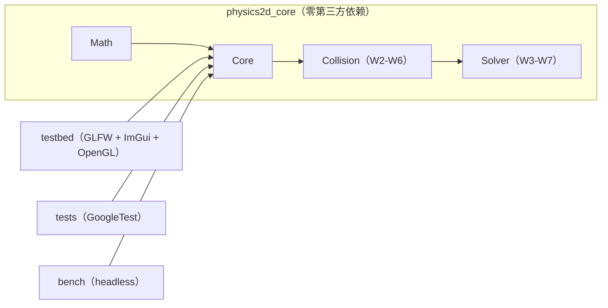

# Physics2D — 从零手写的 2D 刚体物理引擎

> 一个用于校招简历与面试深挖的 C++20 项目：完整走通
> **宽相 → 窄相 → 接触流形 → Sequential Impulse 求解 → 岛屿休眠** 的链路，
> 物理核心零第三方依赖、可 headless 回归、用 Tracy 量化每一阶段耗时。

**当前进度：Week 1 完成**（数学库 + Body/World 积分骨架 + OpenGL/ImGui 测试台 + 单测/CI 骨架，
Week 2-8 的接口已预留）。详细计划见 [`docs/ROADMAP.md`](docs/ROADMAP.md)，
接口预留清单见 [`docs/dev-interfaces.md`](docs/dev-interfaces.md)。

> 演示 GIF 将在对应 demo 落地后补上（Week 4+：10 方块堆叠 / 200 物体 SAP 对比 / 500 物体休眠）。

## ✨ 已实现（Week 1）

- **数学库**（`p2::Math`）：`Vec2`（三种 `Cross` 重载）、`Mat2`（列主序、求逆）、
  `Rot`（存 cos/sin 避免角度漂移）、`Transform`、`AABB`（fat AABB 语义）、`MathUtils`（FNV-1a）。
- **Core 骨架**（`p2::Core`）：`Body`/`BodyDef`/`BodyType`、generation 计的 `Handle` + `IDPool`、
  `World`（创建/销毁/状态访问器 + 固定 11 阶段 `Step` 流水线骨架）、semi-implicit Euler 积分、
  单步位移钳制、`StepAccumulator` 固定步长、Debug `CheckSane` NaN 扫描。
- **可交互测试台**：GLFW + OpenGL 3.3 Core + Dear ImGui(docking)，自写最小 GL loader、
  线框批处理渲染器、中键平移/滚轮缩放相机、参数面板；Week 1 demo：重力下落球 + 旋转方块。
- **工程质量**：CMake presets（Debug/Release/Sanitize/Headless + VS2022 兜底）、
  GoogleTest 单测（Eigen 交叉验证）、ASan/UBSan 预设、GitHub Actions CI（双平台 + sanitize + headless + 分层守卫）。
- **为 Week 2-8 预留**：`IBroadPhase` 可插拔宽相、`ContactID`/`Manifold`/`ContactPoint`/`Contact`
  数据契约、`World::Step` 的空阶段方法、`SolverSettings`、`Profiler` 零成本宏、回归/bench 目录与 target 名。

## 🚀 快速开始（Windows）

```powershell
# 1) 一次性环境检查（VS2022 C++ 工作负载、CMake、Git、Ninja）
powershell -NoProfile -ExecutionPolicy Bypass -File scripts/bootstrap.ps1

# 2) 配置 + 编译 + 跑单测
powershell -NoProfile -ExecutionPolicy Bypass -File scripts/build.ps1 -Preset debug -RunTests

# 3) 启动测试台
.\build\debug\testbed\physics2d_testbed.exe
```

Linux：

```bash
sudo apt install -y build-essential cmake ninja-build libgl1-mesa-dev xorg-dev
./scripts/build.sh debug --tests
```

> 依赖（GoogleTest/Eigen/GLFW/Dear ImGui）由 CMake `FetchContent` 在首次 configure 时拉取，
> 不需要 vcpkg。详见 [`docs/dev-setup.md`](docs/dev-setup.md)。

## 🏗️ 架构



- **分层铁律**：`physics2d_core` 不 include 任何渲染/UI 头（Tracy 例外），CI 有 grep 守卫。
- 正式文档：[`docs/architecture.md`](docs/architecture.md)。

## 📁 目录

```text
include/physics2d/{Math,Core,Collision,Solver}/   # 公共头（Collision/Solver 为预留类型）
src/{Math,Core}/                                  # Week 1 实现（core 静态库）
testbed/                                          # 渲染 + ImGui 测试台 + demo
tests/unit/                                       # GoogleTest 单测；tests/regression/ 为 W6-7 预留
bench/                                            # headless 基准（W6 预留）
docs/                                             # 架构、接口预留清单、环境、开发日志、Roadmap
scripts/                                          # bootstrap / build / format / pre-commit
```

## 📊 测试与性能

- 单测：**120 个 ctest 用例**（112 个常规 + 8 个 debug death test）。`debug` / `release` /
  `sanitize`（MSVC ASan）三套 preset 全绿，MSVC `/W4 /permissive-` 零警告。
  本机 sandbox 环境下 8 个 death test 自动 SKIP（无法写临时文件），把测试 exe 复制到工作区外运行即 **120/120 全过**。
- 命令：`ctest --test-dir build/debug --output-on-failure`；
  sanitize：`powershell -File scripts/build.ps1 -Preset sanitize -RunTests`。
- 性能数据表（SAP vs BruteForce、warm starting、休眠）将在 Week 5-8 用实测数字填入
  `docs/profiling.md` 与 README —— 本仓库不写没有测量条件的数字。

## 🗺️ Roadmap

| 周 | 主题 | 状态 |
| --- | --- | --- |
| W1 | 数学库 + CMake + 渲染循环 + 积分骨架 | ✅ |
| W2 | 形状/平面/圆解析碰撞 + Contact 数据 | ⬜ |
| W3 | Sequential Impulse（法向） | ⬜ |
| W4 | SAT + 裁剪式 Manifold + 冷热数据拆分 | ⬜ |
| W5 | 摩擦/warm starting/split impulse + 参数面板 | ⬜ |
| W6 | Broad Phase（BruteForce + SAP）与量化 | ⬜ |
| W7 | 岛屿休眠 + demo 集 + headless 回归 | ⬜ |
| W8 | 文档/性能表/面试准备 | ⬜ |

完整验收标准见 [`docs/ROADMAP.md`](docs/ROADMAP.md)。

## ⚠️ 已知限制（Week 1）

- 还没有碰撞与约束求解：`World::Step` 目前只做积分，物体之间会互相穿过（Week 2-5 逐步补齐）。
- 只有一个 demo（FallingBall）；demo 集在 Week 4-7 增加。
- `Body` 暂为单一结构（内含冷/热分区），Week 4 计划拆成 `BodySim`/`BodyState` 并行数组。
- 测试台需要可用的 OpenGL 上下文；无显示环境请用 `--smoke`（只验证初始化/循环，不验证画面）。
- Tracy 剖析仅保留零成本钩子，正式接入在 Week 6-8。

## 📚 参考

Box2D（Erin Catto）、*Iterative Dynamics with Temporal Coherence* (GDC 2005)、
*Real-Time Collision Detection* (Christer Ericson)、Randy Gaul 的 impulse solver 系列文章。

## License

[MIT](LICENSE)
