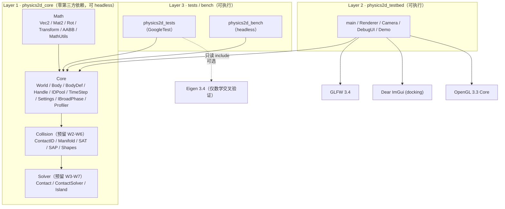
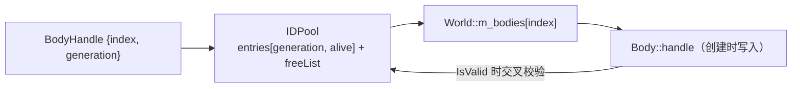
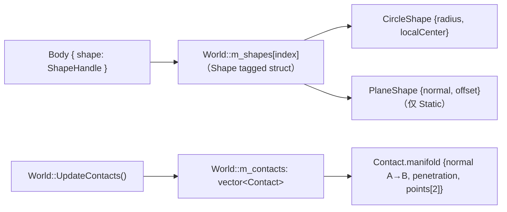

# 架构说明（Week 1-3）

> 本文描述**当前已实现**的架构，以及为 Week 2-8 预留的挂载点。
> 公式推导见设计文档第 6 章与未来 `docs/math.md`；接口预留清单见 `docs/dev-interfaces.md`。

## 1. 分层与依赖方向



**铁律**：`physics2d_core` 的 include 目录里不允许出现 GLFW / OpenGL / ImGui / SDL 头文件
（Tracy 是唯一例外，且只在 `TRACY_ENABLE` 下通过 `Core/Profiler.h` 引入）。
CI 的 `layering` job 用 grep 强制这条规则，headless job 则证明核心可无渲染运行。

## 2. 模块职责与边界

| 模块 | 负责 | 不负责 |
| --- | --- | --- |
| `Math` | 值语义向量/旋转/变换/AABB、数学常量、FNV-1a hash | 任何物理语义、任何 I/O |
| `Core` | World 生命周期、Step 流水线、Body/Shape 池、句柄/ID 池、固定步长、Settings、接触列表、可插拔宽相接口、Profiler 钩子 | SAT/裁剪（W4）、冲量求解（W3）、岛屿休眠（W7） |
| `Collision` | 形状数据（Circle/Plane）、解析碰撞（圆-圆、圆-平面）、Manifold、ContactID、Contact 数据 | 冲量求解；多边形 SAT/裁剪（W4 加入） |
| `Solver` | **W3：法向 Sequential Impulse**（`ContactSolver`：K_n、累计冲量钳制、迭代、restitution bias）；W5 摩擦/warm starting/split impulse；W7 岛屿休眠与按岛求解 | 渲染、UI、宽相 |
| `testbed` | 窗口/输入/渲染/ImGui/相机/Demo | 任何物理算法 |
| `tests` | 单测（L1）+ 场景断言（L2） | 性能结论（bench 负责） |
| `bench`（预留） | headless 宽相/求解器基准 | 渲染 |

> 依赖方向：`World`（Core）只**前向声明** `ContactSolver`，实现文件才 include Solver 头文件，
> 因此 Core 的公共头不会把 Solver 拖进编译单元；两个模块同属 `physics2d_core` 静态库。

## 3. 关键数据布局

### 3.1 Body：冷热分离（Week 1 单结构，Week 4 拆分）

`include/physics2d/Core/Body.h` 按设计文档 3.3 节把字段分成两组，并在注释里标出：

- **冷数据**（组织性，用户/UI 访问）：`handle`、`type`、`shape`、材质参数、`allowSleep`、
  `isAwake`、`userData`、`debugName`。
- **热数据**（积分器/求解器每帧读写）：`xf`、`linearVelocity`、`angularVelocity`、
  `force`/`torque`、质量与逆质量、`sleepTime`、`islandId`、`aabb`。

Week 1-3 用单一 `Body` 结构跑通；**Week 4 的计划重构**把它拆成 `Body`（冷）+ `BodySim` + `BodyState`
三个并行数组。为了让这次拆分不动外部代码，`World` 的公共 API 只暴露**基本类型访问器**
（`GetPosition` / `GetLinearVelocity` / `GetMass` …），`GetBody()` / `GetBodies()` 明确标注为
debug/testbed 用途。详见 `docs/dev-interfaces.md`。

### 3.2 Handle 与 IDPool



- `World::CreateBody` 从 `IDPool` 取槽位，`m_bodies` 按 index 存 Body；槽位**永不压实**，所以
  索引稳定。
- `DestroyBody` 释放槽位、`generation++`，旧句柄自动失效（解决 ABA / 悬垂句柄）。
- `World::IsValid(handle)` = `IDPool::IsValid(index) && pool.GetGeneration(index) == handle.generation`。

### 3.3 时间步（固定步长 + accumulator）

```mermaid
flowchart LR
    FT["frameTime（可变）"] --> SA["StepAccumulator::Advance()"]
    SA -->|"steps ∈ [0,5]"| WS["World::Step(dt=1/60) × N"]
    SA -->|alpha ∈ [0,1)| RI["渲染插值（Week 7 可选）"]
```

- 物理永远只看到 `kFixedTimeStep = 1/60`；warm starting 与 split impulse 的假设都依赖固定 dt。
- 单帧最多 `kMaxStepsPerFrame = 5` 步，超出的时间被丢弃，避免卡顿→更多步→更卡的死亡螺旋。
- `StepAccumulator` 是纯值类型、无 GLFW 依赖，因此可以直接单测。

### 3.4 形状池与接触列表（Week 2）



- 几何由 World 的形状池持有（`IDPool` + `std::vector<Shape>`，与 body 相同的槽位/generation 纪律），
  `Body::shape` 只存句柄。一个 body 最多一个 shape（`World::AttachShape` 会重算质量/惯性）。
- 质量推导：`mass = density * shape.area`；圆形 `I = 0.5*m*r²`，`localCenter ≠ 0` 时按平行轴定理
  折算到 body 原点（Week 2 的简化：body 原点即旋转中心）。
- `Contact` 由 World 拥有并按帧重建；`m_previousContacts` 保留上一帧，用于按 `ContactID::Key()`
  继承接触点的累计冲量（Week 5 warm starting 的直接前置）。设计文档把 `Contact` 放在 Solver，
  但它是窄相输出且 World 必须持有列表，所以 Week 2 把文件移到 `Collision/Contact.h`
  （字段语义保持不变，见 `docs/dev-interfaces.md` 偏差登记）。
- Week 2 的配对枚举仍是 **O(N²) + AABB 过滤**（`Body::aabb` 在 `Synchronize()` 里由形状算出），
  `UpdateBroadPhase()` 保持空实现；Week 6 只替换枚举来源（`IBroadPhase`），接触数据契约不变。

## 4. World::Step 流水线（固定顺序，Week 1-3 已实现 7 个阶段）

| # | 阶段 | Week 1-3 状态 | 预留方法 |
| --- | --- | --- | --- |
| 1 | 积分力 → 速度（semi-implicit） | ✅ 已实现 | `IntegrateForces` |
| 2 | Broad Phase 更新 / 生成候选对 | ⬜ 预留 W6 | `UpdateBroadPhase` |
| 3 | Narrow Phase → Contact/Manifold | ✅ W2：O(N²)+AABB 过滤 + 解析圆族 | `UpdateContacts` |
| 4 | 岛屿构建（DFS） | ⬜ 预留 W7 | `BuildIslands` |
| 4b | 求解器准备（每点 rA/rB、K_n、restitution bias） | ✅ W3 | `PrepareConstraints` |
| 5 | Warm Start | 🟡 W3 空实现（W5 实装） | `WarmStart` |
| 6 | 速度迭代（Sequential Impulse，法向） | ✅ W3（W5 加摩擦/warm start/split impulse） | `SolveVelocityConstraints` |
| 7 | 积分速度 → 位置（+ 单步钳制） | ✅ 已实现 | `IntegratePositions` |
| 8 | 位置迭代（split impulse / Baumgarte） | 🔶 W3：仅位置推出（W5 换 split impulse） | `SolvePositionConstraints` |
| 9 | 同步 transform / AABB | ✅ W2：由形状算 AABB | `Synchronize` |
| 10 | 休眠判定 | ⬜ 预留 W7 | `UpdateSleep` |
| 11 | Debug 校验（NaN/Inf 扫描） | ✅ 已实现 | `Validate` |

顺序不可变（设计文档 4.6 节）。空阶段保留为**具名的私有方法 + 注释**，后续每周只填一个方法
的函数体，从而保持编译期结构不变、避免"在 Step 中间插一段"引发的顺序回归。

### 4.1 Week 2 的临时响应（已在 Week 3 部分清偿）

Week 2 为了先跑通"球落在地面停住"实现了一个**故意错误**的临时响应，并在 devlog 里记录它为什么
不够；Week 3 已经把其中的速度部分换成真正的 Sequential Impulse：

1. ~~**法向速度投影（restitution 版）**~~ → **Week 3 删除**，由 `Solver/ContactSolver` 取代；
2. **位置推出**仍保留：`correction = clamp((penetration - kLinearSlop) * kPositionCorrectionFactor,
   0, kMaxLinearCorrection)`，按逆质量加权沿法线移动两个 body。它只改位置、不守恒，
   Week 5 用 split impulse 的伪速度层替换（`SolvePositionConstraints` 里仍有 `TEMPORARY` 标记）。

### 4.2 Week 3: Sequential Impulse（法向）

`Solver/ContactSolver.h` 的约定（与设计文档 6.4 / P08 一致）：

- **有效质量**：`K_n = invMassA + invMassB + invIA·Cross(rA,n)² + invIB·Cross(rB,n)²`；
  求解器缓存 `normalMass = 1/K_n`。`K_n` 非正的接触点（两个无限质量物体/退化）被跳过并 debug assert。
- **相对速度**：`vRel = (vB + ωB×rB) − (vA + ωA×rA)`，`vn = Dot(vRel, normal)`。
- **单次迭代**：`λ = -(vn + bias) · normalMass`；累计钳制
  `newAcc = max(acc + λ, 0)`、`Δλ = newAcc − acc`；把 `Δλ·n` 以线性+角速度增量施加到 A(−)/B(+)。
- **restitution bias**：`Prepare` 时记录初始接近速度 `vn0 < 0`；仅当 `−vn0 > restitutionThreshold`
  时 `bias = e · vn0`（负值），使目标相对法向速度变成 `−e·vn0`（分离）。
  低速接触 bias=0，避免静止堆叠在微小接近速度下永远弹跳。
- **持久化**：本帧累计冲量写回 `ContactPoint::normalImpulse`；Week 3 每帧从 0 开始（无 warm start），
  Week 5 才改为跨帧继承 + `WarmStart` 施加。
- **迭代次数**：`World::Step(dt, velocityIterations, positionIterations)` 的两个计数现在真正生效
  （W3 只用 velocityIterations；positionIterations 在 W5 的位置迭代使用）。
- 无摩擦/无 warm start/无 split impulse：这些是 Week 5 的增量，`ContactConstraintPoint` 已预留扩展空间。

## 5. 已冻结的公共接口

Week 3 之后**不应再改签名**的接口（改动会波及后续 5 周与 testbed）：

- `World` 的全部 public 方法（生命周期、状态访问器、形状池、接触列表、`Step`、`SetGravity`、
  `SetSolverSettings`、`SetBroadPhase`、统计、`CheckSane`、`Clear`）。
- `BodyDef` / `Body` / `BodyType` / `Handle<T>` / `IDPool` / `StepAccumulator` / `SolverSettings`。
- `Shape` / `ShapeType` / `MassData` / `CircleShape` / `PlaneShape`，以及
  `CollideCircles` / `CollideCircleAndPlane` / `CollidePlaneAndCircle` / `FlipManifold`。
- `IBroadPhase`、`ContactID`、`Manifold`、`ContactPoint`、`Contact`（字段可追加，
  但既有字段语义不变）。
- `Solver/ContactSolver.h` 的 `ContactSolver` 接口与 `ContactConstraintPoint` 字段
  （Week 5 会**追加**切向/摩擦、warm start、split impulse 字段，不改已有语义）。
- `p2::Math` 全部函数签名。
- `Settings.h` 常量名（只允许追加新常量）。

新增能力优先**追加**：新字段追加到结构体尾部、新方法追加到 `World`、新阶段填已有预留方法
（Week 4 的 `PolygonShape` 就追加为 `Shape::polygon` 成员 + `ShapeType::Polygon`）。
破坏性修改必须在 `docs/dev-interfaces.md` 的"偏差"一节登记理由。

## 6. 确定性（Determinism）

已落实的规则（详见设计文档 7.4）：

1. 固定 dt，物理不读 wall-clock 时间。
2. 迭代/求解顺序由 `std::vector` 下标决定；不使用 `unordered_map` 的遍历顺序。
3. 不依赖浮点环境（未开 `-ffast-math`）。
4. 场景生成使用带种子的 `std::mt19937`，只出现在场景构造，不进物理计算。
5. `MathUtils` 提供 FNV-1a（float 位模式 + 量化弱 hash），为 Week 6-7 的 headless 回归
   奠基（同平台逐位一致；跨平台用弱 hash / 阈值断言）。

## 7. 性能剖析钩子（预留 W6-W8）

`Core/Profiler.h` 定义了 `P2_PROFILE_ZONE_N(...)` / `P2_PROFILE_PLOT(...)` 等零成本宏：

- `TRACY_ENABLE` 未定义（默认）时展开为 `((void)0)`，无任何运行时开销；
- `PHYSICS2D_ENABLE_TRACY=ON` + `PHYSICS2D_TRACY_ROOT=<tracy 源目录>` 时定义该宏并 link 头文件，
  引擎源码无需改动即可采集 Step 各阶段耗时。

## 8. 测试体系（当前）

| 层 | 内容 | 位置 |
| --- | --- | --- |
| L1 单测 | 数学库、形状质量/AABB、圆族解析碰撞、求解器数学（K_n/单次冲量/迭代收敛/restitution bias）、IDPool、accumulator、预留接口编译 | `tests/unit/` |
| L2 组件 | 完整 Step 场景断言（坠落/钳制/销毁/形状附着/接触持久化/动量守恒/反弹高度/确定性） | `tests/unit/test_world_*.cpp` |
| L3 回归 | 预留（`tests/regression/`，W6-W7） | — |

`ctest --preset all` 通过 `gtest_discover_tests` 把每个 TEST 变成独立 ctest 用例。
