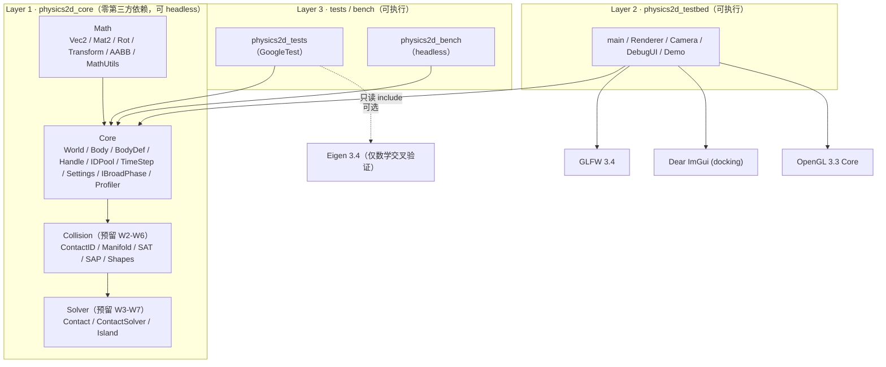

# 架构说明（Week 1）

> 本文描述**当前已实现**的架构，以及为 Week 2-8 预留的挂载点。
> 公式推导见设计文档第 6 章与未来 `docs/math.md`；接口预留清单见 `docs/dev-interfaces.md`。

## 1. 分层与依赖方向



**铁律**：`physics2d_core` 的 include 目录里不允许出现 GLFW / OpenGL / ImGui / SDL 头文件
（Tracy 是唯一例外，且只在 `TRACY_ENABLE` 下通过 `Core/Profiler.h` 引入）。
CI 的 `layering` job 用 grep 强制这条规则，headless job 则证明核心可无渲染运行。

## 2. 模块职责与边界

| 模块 | 负责 | 不负责 |
| --- | --- | --- |
| `Math` | 值语义向量/旋转/变换/AABB、数学常量、FNV-1a hash | 任何物理语义、任何 I/O |
| `Core` | World 生命周期、Step 流水线骨架、Body 数据、句柄/ID 池、固定步长、Settings、可插拔宽相接口、Profiler 钩子 | 碰撞检测、约束求解（均为预留阶段） |
| `Collision`（预留） | 形状、SAT、裁剪、Manifold、Broad Phase 实现 | 冲量求解 |
| `Solver`（预留） | Contact 求解、warm starting、岛屿、休眠 | 渲染、UI |
| `testbed` | 窗口/输入/渲染/ImGui/相机/Demo | 任何物理算法 |
| `tests` | 单测（L1）+ 场景断言（L2） | 性能结论（bench 负责） |
| `bench`（预留） | headless 宽相/求解器基准 | 渲染 |

## 3. 关键数据布局

### 3.1 Body：冷热分离（Week 1 单结构，Week 4 拆分）

`include/physics2d/Core/Body.h` 按设计文档 3.3 节把字段分成两组，并在注释里标出：

- **冷数据**（组织性，用户/UI 访问）：`handle`、`type`、`shape`、材质参数、`allowSleep`、
  `isAwake`、`userData`、`debugName`。
- **热数据**（积分器/求解器每帧读写）：`xf`、`linearVelocity`、`angularVelocity`、
  `force`/`torque`、质量与逆质量、`sleepTime`、`islandId`、`aabb`。

Week 1-3 用单一 `Body` 结构跑通；**Week 4 的计划重构**把它拆成 `Body`（冷）+ `BodySim` + `BodyState`
三个并行数组。为了让这次拆分不动外部代码，`World` 的公共 API 只暴露**基本类型访问器**
（`GetPosition` / `GetLinearVelocity` / `GetMass` …），`GetBody()` / `GetBodies()` 明确标注为
debug/testbed 用途。详见 `docs/dev-interfaces.md`。

### 3.2 Handle 与 IDPool


- `World::CreateBody` 从 `IDPool` 取槽位，`m_bodies` 按 index 存 Body；槽位**永不压实**，所以
  索引稳定。
- `DestroyBody` 释放槽位、`generation++`，旧句柄自动失效（解决 ABA / 悬垂句柄）。
- `World::IsValid(handle)` = `IDPool::IsValid(index) && pool.GetGeneration(index) == handle.generation`。

### 3.3 时间步（固定步长 + accumulator）

```mermaid
flowchart LR
    FT["frameTime（可变）"] --> SA["StepAccumulator::Advance()"]
    SA -->|"steps ∈ [0,5]"| WS["World::Step(dt=1/60) × N"]
    SA -->|alpha ∈ [0,1)| RI["渲染插值（Week 7 可选）"]
```

- 物理永远只看到 `kFixedTimeStep = 1/60`；warm starting 与 split impulse 的假设都依赖固定 dt。
- 单帧最多 `kMaxStepsPerFrame = 5` 步，超出的时间被丢弃，避免卡顿→更多步→更卡的死亡螺旋。
- `StepAccumulator` 是纯值类型、无 GLFW 依赖，因此可以直接单测。

## 4. World::Step 流水线（固定顺序，Week 1 只实现 3 个阶段）

| # | 阶段 | Week 1 状态 | 预留方法 |
| --- | --- | --- | --- |
| 1 | 积分力 → 速度（semi-implicit） | ✅ 已实现 | `IntegrateForces` |
| 2 | Broad Phase 更新 / 生成候选对 | ⬜ 预留 W6 | `UpdateBroadPhase` |
| 3 | Narrow Phase → Contact/Manifold | ⬜ 预留 W2-W5 | `UpdateContacts` |
| 4 | 岛屿构建（DFS） | ⬜ 预留 W7 | `BuildIslands` |
| 5 | Warm Start | ⬜ 预留 W5 | `WarmStart` |
| 6 | 速度迭代（Sequential Impulse） | ⬜ 预留 W3-W5 | `SolveVelocityConstraints` |
| 7 | 积分速度 → 位置（+ 单步钳制） | ✅ 已实现 | `IntegratePositions` |
| 8 | 位置迭代（split impulse / Baumgarte） | ⬜ 预留 W5 | `SolvePositionConstraints` |
| 9 | 同步 transform / AABB | ⬜ 预留 W6 | `Synchronize` |
| 10 | 休眠判定 | ⬜ 预留 W7 | `UpdateSleep` |
| 11 | Debug 校验（NaN/Inf 扫描） | ✅ 已实现 | `Validate` |

顺序不可变（设计文档 4.6 节）。空阶段保留为**具名的私有方法 + 注释**，后续每周只填一个方法
的函数体，从而保持编译期结构不变、避免"在 Step 中间插一段"引发的顺序回归。

## 5. 已冻结的公共接口

Week 1 之后**不应再改签名**的接口（改动会波及后续 8 周与 testbed）：

- `World` 的全部 public 方法（生命周期、状态访问器、`Step`、`SetGravity`、`SetSolverSettings`、
  `SetBroadPhase`、统计、`CheckSane`、`Clear`）。
- `BodyDef` / `Body` / `BodyType` / `Handle<T>` / `IDPool` / `StepAccumulator` / `SolverSettings`。
- `IBroadPhase`、`ContactID`、`Manifold`、`ContactPoint`、`Contact`（预留类型，字段可追加，
  但既有字段语义不变）。
- `p2::Math` 全部函数签名。
- `Settings.h` 常量名（只允许追加新常量）。

新增能力优先**追加**：新字段追加到结构体尾部、新方法追加到 `World`、新阶段填已有预留方法。
破坏性修改必须在 `docs/dev-interfaces.md` 的"偏差"一节登记理由。

## 6. 确定性（Determinism）

已落实的规则（详见设计文档 7.4）：

1. 固定 dt，物理不读 wall-clock 时间。
2. 迭代/求解顺序由 `std::vector` 下标决定；不使用 `unordered_map` 的遍历顺序。
3. 不依赖浮点环境（未开 `-ffast-math`）。
4. 场景生成使用带种子的 `std::mt19937`，只出现在场景构造，不进物理计算。
5. `MathUtils` 提供 FNV-1a（float 位模式 + 量化弱 hash），为 Week 6-7 的 headless 回归
   奠基（同平台逐位一致；跨平台用弱 hash / 阈值断言）。

## 7. 性能剖析钩子（预留 W6-W8）

`Core/Profiler.h` 定义了 `P2_PROFILE_ZONE_N(...)` / `P2_PROFILE_PLOT(...)` 等零成本宏：

- `TRACY_ENABLE` 未定义（默认）时展开为 `((void)0)`，无任何运行时开销；
- `PHYSICS2D_ENABLE_TRACY=ON` + `PHYSICS2D_TRACY_ROOT=<tracy 源目录>` 时定义该宏并 link 头文件，
  引擎源码无需改动即可采集 Step 各阶段耗时。

## 8. 测试体系（当前）

| 层 | 内容 | 位置 |
| --- | --- | --- |
| L1 单测 | 数学库、IDPool、accumulator、World 积分骨架、预留接口编译 | `tests/unit/` |
| L2 组件 | 完整 Step 场景断言（坠落/钳制/销毁） | `tests/unit/test_world_step.cpp` |
| L3 回归 | 预留（`tests/regression/`，W6-W7） | — |

`ctest --preset all` 通过 `gtest_discover_tests` 把每个 TEST 变成独立 ctest 用例。
