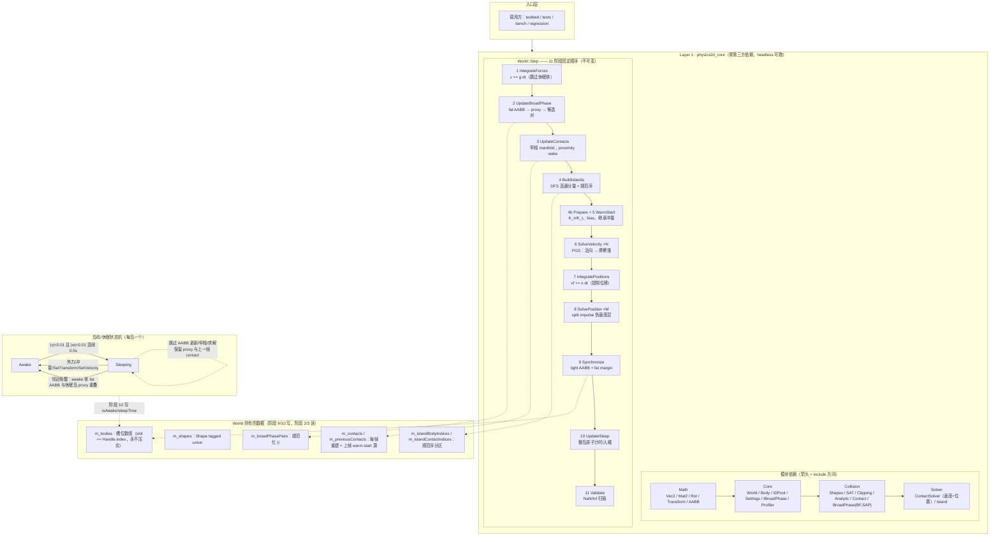
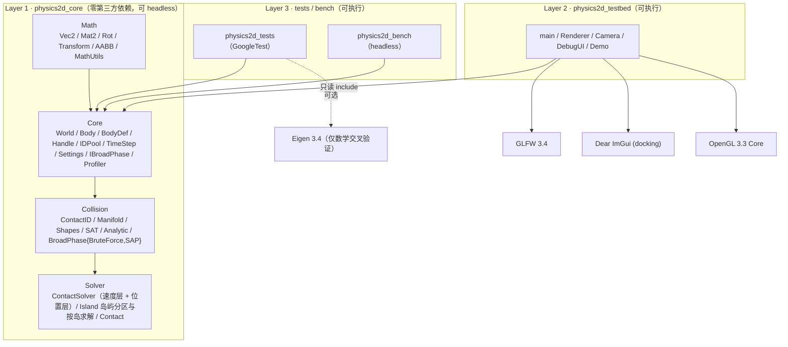
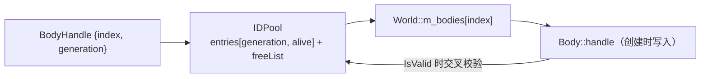
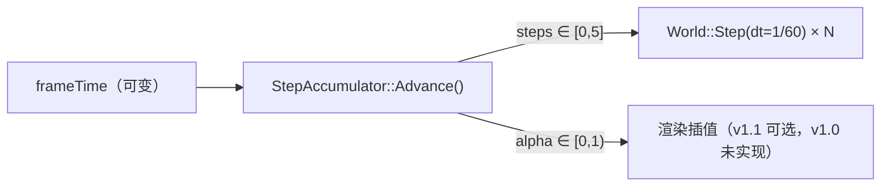
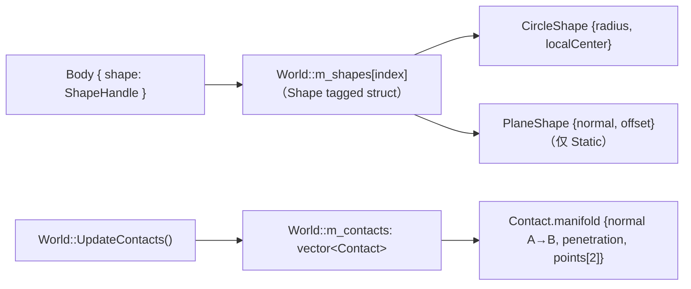
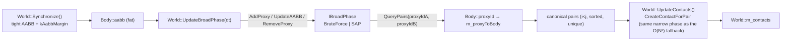
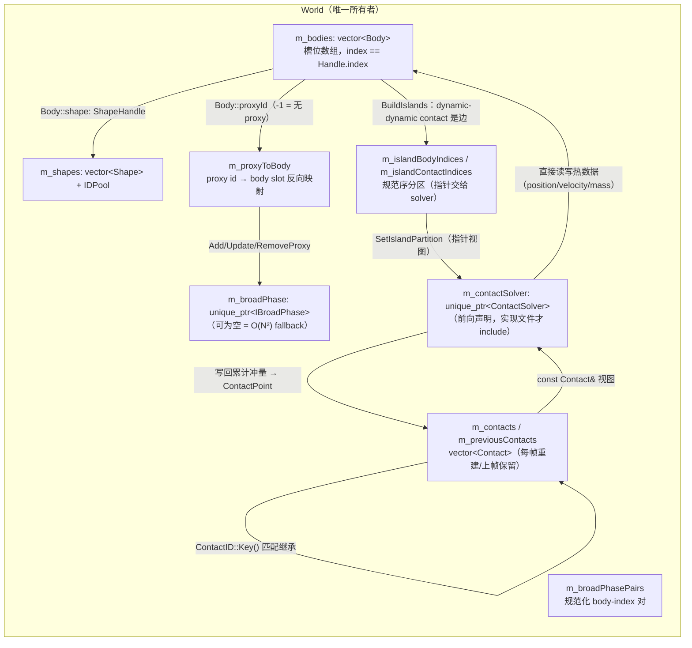
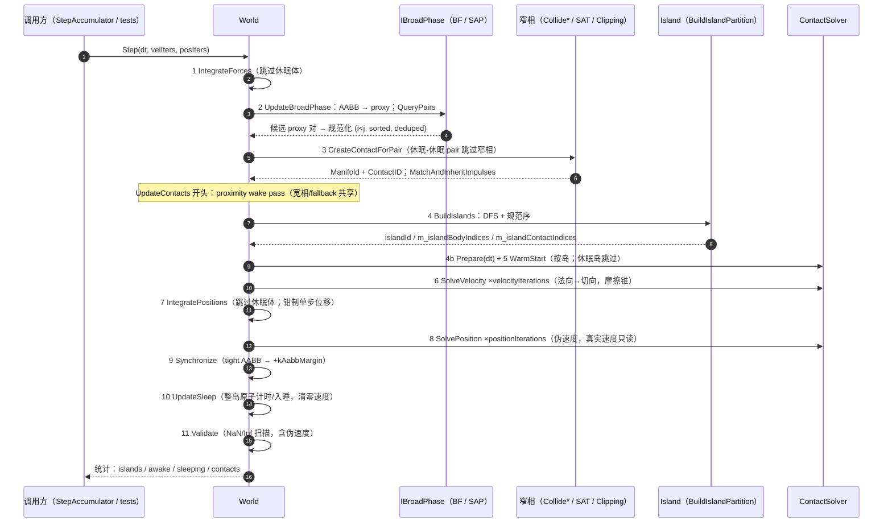
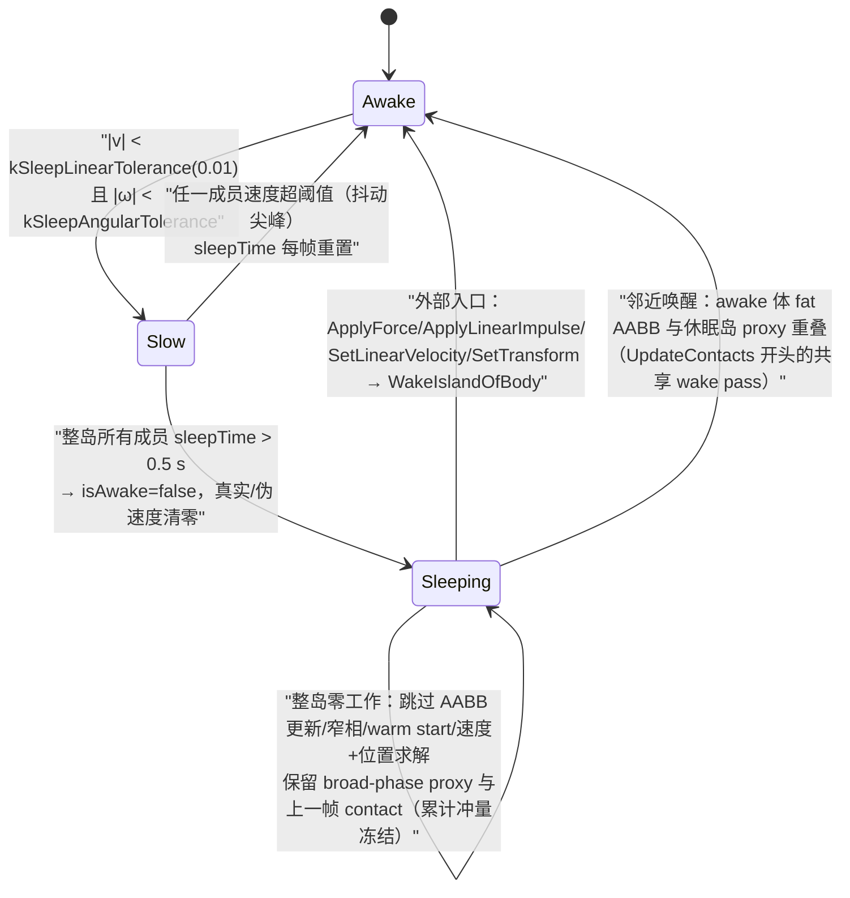

# 架构说明（Week 1-8 · v1.0）

> 本文描述 **v1.0-release 已实现**的架构：分层与依赖、数据结构与所有权、`World::Step` 的 11 阶段
> 流水线、宽相/窄相/求解/岛屿休眠的数据流与关键设计理由。
> 公式推导见 [`math.md`](math.md)；全部实测性能数字与测量条件见 [`profiling.md`](profiling.md)；
> 边界契约与已知限制见 [`boundary-contracts.md`](boundary-contracts.md)；接口预留清单与偏差登记见
> [`dev-interfaces.md`](dev-interfaces.md)。
>
> Week 8 是文档与交付周：**物理行为与公共 API 均未改变**（回归弱 hash 同一 toolchain 内不变：MSVC `588d30e70f9b4ddd` / GCC `001d846118f05125`），
> 新增内容只有文档、边界测试与 testbed 的帧捕获工具。

## 0. 一张图总览（W8 新增）

这张图把四个视角压在一页里：**模块依赖方向**（Layer 1/2/3）、**Step 的 11 阶段时序**（实线箭头）、
**数据所有权**（虚线指向 World 持有的容器）、**岛屿/休眠状态机**（右下角，与阶段 4/10 对应）。
细节分别见 §1（模块）、§3（数据布局）、§4（流水线）、§4.6（时序图）、§4.7（状态机）。

**读图要点**

1. **依赖只有一个方向**：`Math → Core → Collision → Solver`。Core 的公共头只前向声明
   `ContactSolver`（实现文件才 include Solver 头），所以用户 include `World.h` 不会把求解器拖进编译单元；
   `physics2d_core` 静态库里两者是同一条链，不构成单独的库。
2. **11 个阶段是顺序依赖的**：宽相用上一步 `Synchronize` 写下的 AABB（一步滞后，由 fat margin 吸收）；
   接触锚点是**生成时刻**的几何（`IntegratePositions` 之前）；位置层在 `IntegratePositions` 之后必须
   用新 transform 重算杠杆臂。
3. **休眠是整岛原子的状态机**：进入/离开 `Sleeping` 的最小单位是岛，不是 body；休眠岛保留 proxy 与
   上一帧 contact，因此仍参与"邻近唤醒"判定、仍可被整岛唤醒。
4. **数据所有权**：所有容器归 `World`；`Body::proxyId` / `Body::islandId` 只是 bookkeeping，宽相与
   岛屿模块本身不拥有 body。

## 1. 分层与依赖方向

**铁律**：`physics2d_core` 的 include 目录里不允许出现 GLFW / OpenGL / ImGui / SDL 头文件
（Tracy 是唯一例外，且只在 `TRACY_ENABLE` 下通过 `Core/Profiler.h` 引入）。
CI 的 `layering` job 用 grep 强制这条规则，headless job 则证明核心可无渲染运行。

## 2. 模块职责与边界

| 模块 | 负责 | 不负责 |
| --- | --- | --- |
| `Math` | 值语义向量/旋转/变换/AABB、数学常量、FNV-1a hash | 任何物理语义、任何 I/O |
| `Core` | World 生命周期、Step 流水线、Body/Shape 池、句柄/ID 池、固定步长、Settings、接触列表、可插拔宽相接口、Profiler 钩子 | SAT/裁剪（W4）、冲量求解（W3）、岛屿休眠（W7） |
| `Collision` | 形状数据（Circle/Plane/**Polygon**）、解析碰撞（圆族 + 圆-多边形 + 多边形-平面）、**SAT + 裁剪式 Manifold**、SATCache、ContactID、Contact 数据；**W6：宽相实现 `BroadPhaseBruteForce` + `BroadPhaseSAP`** | 冲量求解 |
| `Solver` | **W3：法向 Sequential Impulse**；**W5：摩擦锥 + warm starting + split impulse 位置层**；**W7：岛屿分区（DFS）与三种按岛求解模式**（岛屿/休眠状态本身由 World 持有） | 渲染、UI、宽相 |
| `testbed` | 窗口/输入/渲染/ImGui/相机/Demo | 任何物理算法 |
| `tests` | 单测（L1）+ 场景断言（L2） | 性能结论（bench 负责） |
| `bench`（预留） | headless 宽相/求解器基准 | 渲染 |

> 依赖方向：`World`（Core）只**前向声明** `ContactSolver`，实现文件才 include Solver 头文件，
> 因此 Core 的公共头不会把 Solver 拖进编译单元；两个模块同属 `physics2d_core` 静态库。

## 3. 关键数据布局

### 3.1 Body：冷热分离（v1.0 仍为单一 Body 结构；拆分推迟到 v1.1）

`include/physics2d/Core/Body.h` 按设计文档 3.3 节把字段分成两组，并在注释里标出：

- **冷数据**（组织性，用户/UI 访问）：`handle`、`type`、`shape`、材质参数、`allowSleep`、
  `isAwake`、`userData`、`debugName`。
- **热数据**（积分器/求解器每帧读写）：`xf`、`linearVelocity`、`angularVelocity`、
  `pseudoLinearVelocity`/`pseudoAngularVelocity`（W5 追加，split impulse 专用）、
  `force`/`torque`、质量与逆质量、`sleepTime`、`islandId`（W7 起为规范岛序编号）、
  `aabb`（W6 起为 fat AABB）、`proxyId`（W6 追加，宽相 bookkeeping）。

Week 1-7 用单一 `Body` 结构跑通；**冷热拆分**（`Body` 冷 + `BodySim`/`BodyState` 并行数组）
W4→W5→W6→W7→W8 连续顺延，**v1.0 最终决定不做**。W7 的测量已经否定了这次重构的收益假设：设计文档
3.3/6.5 期待的"岛内 BodyState 打包"实测在 Release 下**反而更慢**（W8 复测 0.87x；400 bodies 的整个
Body 数组约 80 KB，本来就装得进 L2，每帧 O(bodies) 拷贝成本 > 局部性收益）；W8 的 profiling 汇总（见
[`profiling.md`](profiling.md)）也没有证据表明 body 布局是热点（热点在宽相/求解迭代，且已通过 SAP 与
岛屿休眠解决）。因此"独立 BodySim/BodyState 数组"进入 v1.1 候选（R15），前提是先有 Tracy 实测数据。
`World` 的公共 API 仍只暴露**基本类型访问器**（`GetPosition` / `GetLinearVelocity` / `GetMass` …），
`GetBody()` / `GetBodies()` 明确标注为 debug/testbed 用途——这保证了将来真要做拆分时不会外溢到用户代码。

### 3.2 Handle 与 IDPool

- `World::CreateBody` 从 `IDPool` 取槽位，`m_bodies` 按 index 存 Body；槽位**永不压实**，所以
  索引稳定。
- `DestroyBody` 释放槽位、`generation++`，旧句柄自动失效（解决 ABA / 悬垂句柄）。
- `World::IsValid(handle)` = `IDPool::IsValid(index) && pool.GetGeneration(index) == handle.generation`。

### 3.3 时间步（固定步长 + accumulator）

- 物理永远只看到 `kFixedTimeStep = 1/60`；warm starting 与 split impulse 的假设都依赖固定 dt。
- 单帧最多 `kMaxStepsPerFrame = 5` 步，超出的时间被丢弃，避免卡顿→更多步→更卡的死亡螺旋。
- `StepAccumulator` 是纯值类型、无 GLFW 依赖，因此可以直接单测。

### 3.4 形状池与接触列表（Week 2）

- 几何由 World 的形状池持有（`IDPool` + `std::vector<Shape>`，与 body 相同的槽位/generation 纪律），
  `Body::shape` 只存句柄。一个 body 最多一个 shape（`World::AttachShape` 会重算质量/惯性）。
- 质量推导：`mass = density * shape.area`；圆形 `I = 0.5*m*r²`，`localCenter ≠ 0` 时按平行轴定理
  折算到 body 原点（Week 2 的简化：body 原点即旋转中心）。
- `Contact` 由 World 拥有并按帧重建；`m_previousContacts` 保留上一帧，用于按 `ContactID::Key()`
  继承接触点的累计冲量。Week 5 起这条继承链路是热路径：`ContactPoint::normalImpulse/tangentImpulse`
  → `Prepare` 播种 → `WarmStart` 施加 → `SolveVelocity` 写回。设计文档把 `Contact` 放在 Solver，
  但它是窄相输出且 World 必须持有列表，所以 Week 2 把文件移到 `Collision/Contact.h`
  （字段语义保持不变，见 `docs/dev-interfaces.md` 偏差登记）。
- Week 2-5 的配对枚举是 **O(N²) + AABB 过滤**（`Body::aabb` 在 `Synchronize()` 里由形状算出）。
  **Week 6** 把它换成可插拔宽相（见 §4.4）：`UpdateBroadPhase` 把 body 的 fat AABB 同步给
  `IBroadPhase` 的 proxy，`QueryPairs` 的候选对规范化为 body-index 对后再进窄相；没有安装宽相时
  仍走 O(N²) fallback。接触数据契约完全不变。
- **`Body::aabb` 的语义（W6 起）= fat AABB**：`Synchronize` 先算 tight `ComputeShapeAABB`，
  再 `Extend(kAabbMargin = 0.1 m)`。平面是 `kPlaneAabbExtent`(1e6 m) 超大盒，加 margin 无实际影响。
  fat margin 只扩大候选集，接触的最终判定永远在窄相。

### 3.6 宽相数据流（Week 6）

- proxy↔body 映射由 World 维护：`Body::proxyId`（前向，-1 = 无 proxy）+ `World::m_proxyToBody`
  （反向，proxy id → body slot index）。`IBroadPhase` 只知道 AABB，不认识 Body（Section 4.5 契约）。
- `UpdateBroadPhase` 在 phase 2 运行，用的是**上一步** `Synchronize` 写下的 AABB（离散宽相的标准一步滞后）；
  fat margin 吸收这一步内的小位移。proxy 每步刷新，所以不需要速度外推。
- **顺序规范化是物理正确性的一部分**：接触列表顺序决定 PGS 求解顺序，因此候选对必须排序 + 去重，
  否则"切宽相"会改变最后几位浮点。验收见 §6 与 `docs/dev-interfaces.md` W6 不变量。

### 3.5 多边形与 SAT Manifold（Week 4）

- `PolygonShape` 存 CCW 局部顶点（≤8）、每条边的单位外法线、面积质心；`SetPolygon` 严格校验
  （重复/共线/凹/顺时针/非有限/面积≈0 一律返回 false，不静默修复）。`SetPolygonAsBox` 的顶点顺序
  固定，保证 edge index（进而 ContactID）可复现。
- `CollidePolygons`：对 A、B 两条多边形的所有边法线轴做投影（2D 只需边法线，不需要 3D 的叉积轴），
  取分离最大（穿透最小）的轴；该轴所属面为 **reference face**，另一多边形上与其法线最反向的边为
  **incident face**；用 `Clipping::ClipSegmentToLine` 做两次侧向裁剪 + 一次参考面裁剪，得到 0–2 个
  接触点。法线严格 A→B，`flip` 只是"参考面是否属于 B"的元数据。
- **SATCache**：当两个候选轴的分离值在相对容差内接近时，沿用上一帧的 reference face。
  这只影响 manifold 的轴选择（进而 ContactID 的帧间稳定性），不改变物理结果；
  `SolverSettings::useSatCache` 可关闭它做 D6 对比实验。
- **ContactID 身份**：`Key() = referenceEdge | incidentVertex<<4 | type<<8`，**不包含 flip**。
  同一物理接触在 A/B 交换时 Key 不变——这是 P07 D3/D5 的"交换后 Key 集合相同"要求，
  也是 W5 warm starting 能跨帧匹配的前提。
- 其余解析路径：圆-多边形（最近边/顶点 Voronoi 区域，P06）、多边形-平面（顶点深度，盒底两顶点
  都贴地时返回 2 点，是 BoxStack 稳定支撑的关键）。

### 3.7 数据所有权总图（W8 新增）

所有数据由 `World` 独占持有；模块之间只借指针/索引。这张图回答"谁拥有、谁每帧写、谁只读"：

- `Body::islandId`（无宽相/未启用岛屿时为 -1）、`Body::sleepTime`、`Body::isAwake` 是状态字段，
  不是所有权；testbed/debug UI 通过 `World` 访问器读取。
- `ContactSolver` 的生命周期与 `World` 绑定，`SetIslandPartition` 只传指针视图——分区容器仍归 `World`，
  所以求解器不会在销毁/重建场景时悬空。
- `m_previousContacts` 是 warm starting 与"休眠-休眠 pair 复用"的数据源：每帧 `UpdateContacts` 重建
  `m_contacts` 后交换/匹配，**累计冲量只在 `SolveVelocity` 写回、`Prepare` 读取**。

## 4. World::Step 流水线（固定顺序，v1.0 已实现全部阶段）

| # | 阶段 | 当前状态 | 预留方法 |
| --- | --- | --- | --- |
| 1 | 积分力 → 速度（semi-implicit；跳过休眠体） | ✅ 已实现 | `IntegrateForces` |
| 2 | Broad Phase 更新 / 生成候选对（休眠 body 跳过 AABB 更新、proxy 保留） | ✅ W6 + W7 休眠 | `UpdateBroadPhase(dt)` |
| 3 | Narrow Phase → Contact/Manifold（休眠-休眠 pair 复用上一帧 contact；共享 proximity wake pass） | ✅ W2/W4/W6 + W7 | `UpdateContacts` |
| 4 | 岛屿构建（DFS 显式栈、规范序、islandId） | ✅ W7 | `BuildIslands` |
| 4b | 求解器准备（rA/rB、K_n/K_t、restitution/Baumgarte bias、warm-start 播种；休眠岛不建约束） | ✅ W5 + W7 | `PrepareConstraints(dt)` |
| 5 | Warm Start（按岛/平铺） | ✅ W5 + W7 | `WarmStart` |
| 6 | 速度迭代（法向 + 摩擦锥；岛分组，休眠岛整岛跳过） | ✅ W5 + W7 | `SolveVelocityConstraints` |
| 7 | 积分速度 → 位置（+ 单步钳制；跳过休眠体） | ✅ 已实现 | `IntegratePositions` |
| 8 | 位置迭代（split impulse 伪速度层；休眠岛跳过） | ✅ W5 + W7 | `SolvePositionConstraints(dt)` |
| 9 | 同步 transform / AABB（tight + fat margin） | ✅ W2 + W6 fat AABB | `Synchronize` |
| 10 | 休眠判定（整岛原子计时/入睡） | ✅ W7 | `UpdateSleep(dt)` |
| 11 | Debug 校验（NaN/Inf 扫描，含伪速度） | ✅ 已实现 | `Validate` |

顺序不可变（设计文档 4.6 节）。空阶段保留为**具名的私有方法 + 注释**，后续每周只填一个方法
的函数体，从而保持编译期结构不变、避免"在 Step 中间插一段"引发的顺序回归。

### 4.1 Week 2 的临时响应（Week 5 已全部清偿）

Week 2 为了先跑通"球落在地面停住"实现了一个**故意错误**的临时响应，并在 devlog 里记录它为什么
不够；后续两周把它逐层替换掉，现在仓库里已无 `TEMPORARY` 响应代码：

1. ~~**法向速度投影（restitution 版）**~~ → **Week 3 删除**，由 `Solver/ContactSolver` 取代；
2. ~~**位置推出**~~（`clamp((penetration - kLinearSlop) * kPositionCorrectionFactor, 0, kMaxLinearCorrection)`
   的逆质量加权移动）→ **Week 5 删除**，由 split impulse 伪速度层（`ContactSolver::SolvePosition`）取代；
   `kPositionCorrectionFactor` 常量随之移除（偏差登记见 `dev-interfaces.md` 第 5 节）。

### 4.2 Week 5: 摩擦 + warm starting（速度层）

`Solver/ContactSolver.h` 的约定（与设计文档 6.4 / P09 一致）——法向约束沿用 §4.2 之前的公式，
新增切向约束与 warm start：

- **切向基**：2D 中切向唯一，`t = Skew(normal)`；`K_t` 与 `K_n` 同形（把 normal 换成 tangent）。
- **摩擦锥**：`λt = −(vRel·t)/K_t`；`maxF = μ·accN_new`；**钳累计值**
  `accT = Clamp(accT + λt, −maxF, +maxF)`，`Δλt = accT_new − accT_old` 施加为 `Δλt·t`。
  法向先解、切向后解：摩擦锥半径必须用**更新后**的 accN，否则锥可能在施加切向冲量后收缩。
- **μ 来源**：`contact.friction`（World 在建接触时算 `sqrt(μA·μB)`），求解器不再组合。
- **warm start**：`Prepare` 读 `ContactPoint` 的继承冲量并播种 `acc = inherited·warmStartFactor`
  （`useWarmStarting=false` 或 `isPersistent=false` 时播种 0）；`WarmStart` 施加 `accN·n + accT·t` 一次；
  `SolveVelocity` 迭代后把累计值写回 `ContactPoint`。
  **默认 `warmStartFactor = 1.0`**：实测 factor<1 会每帧丢掉 (1−f) 的已收敛冲量、把 PGS 顺序偏差
  重新注入，10 盒塔随 factor 降低单调提前倒塌（见 devlog W5 数据与偏差登记）。
- **restitution**：`Prepare` 在 warm start **之前**捕获 `vn0`，`−vn0 > restitutionThreshold` 时
  `bias = e·vn0`，否则 0。
- **Baumgarte 对照基线**：仅当 `useSplitImpulse=false` 时，`Prepare` 额外加
  `bias −= (β/dt)·max(0, penetration − linearSlop)`；这是一条速度约束，会向真实速度注入能量，
  专门用于和 split impulse 做对比实验。

### 4.3 Week 5: split impulse 位置层

`Solver/ContactSolverPosition.cpp`（`ContactSolver::SolvePosition`）：

1. **重算约束**：位置层在 `IntegratePositions` 之后运行，所以按**积分后的 transform** 重算
   `rA/rB` 与 `K_n`（速度层的 cache 已过期一步）；锚点在生成时刻重合，因此
   `separation_now = Dot(worldB − worldA, n)`、`penetration_now = manifold.penetration − separation_now`
   （manifold 的 penetration 是生成时刻的，差值即时更新）。
2. **伪速度迭代**：`target = (β/dt)·max(0, penetration_now − splitImpulseSlop)`；
   `λp = −(pseudoVn − target)·K_n⁻¹`；**累计钳制 ≥ 0**（只能推开不能拉回）；
   迭代 `positionIterations` 次（位置在迭代期间冻结，所以 target 恒定）。
3. **一次积分 + 清零**：`xf.p += dt·pseudoLinearVelocity`（长度按 `maxLinearCorrection` 钳制）、
   `xf.q = xf.q·Rot(clamp(dt·pseudoAngularVelocity, ±kMaxAngularCorrection))` 并归一化；
   最后 `ClearPseudoVelocities`。**真实速度全程既不读也不写**——这是"不注入能量"的机制保证，
   单测用逐位比较验证。伪速度每步必须清零，否则会变成求解器看不见的"免费速度"。

### 4.4 Week 6: Broad Phase（`BruteForce` + `SAP`）

两个实现都满足 `Core/BroadPhaseInterface.h`（冻结接口）：`AddProxy(AABB)->id`、`RemoveProxy`、
`UpdateAABB`、`QueryPairs(callback)`、`GetProxyCount`、`Name`。

- **`BroadPhaseBruteForce`**（`src/Collision/BroadPhaseBruteForce.cpp`，参考基线）：
  slot 数组 `vector<AABB>` + `vector<uint8_t> alive` + 空闲列表；`QueryPairs` 固定 `i < j` 双重循环 +
  `AABB::Overlaps`。它是对照 oracle，也是小场景（N < ~30）更快的实现（数据见 README bench 表）。
- **`BroadPhaseSAP`**（`src/Collision/BroadPhaseSAP.cpp`）：
  - 端点表示：**单一** `vector<Endpoint{float value; int32_t proxyId; uint8_t isMin}>`，每个 proxy 两个端点
    （min.x / max.x）。单数组是为了增量更新：一次交换只动 12 字节，value/id/flag 不会失配。
  - 排序策略：`AddProxy` 尾部追加 + 脏标记，在下一个 `UpdateAABB` / `QueryPairs` / `ValidateInternalState`
    观察点做一次 `std::sort`（首帧/场景加载的批量路径）；**稳态** `UpdateAABB` 对两个端点分别
    bubble-left / bubble-right（插入排序思路，利用帧间相干性；swap 时同步维护 proxy 缓存的端点索引）。
  - 扫描：按 proxy id 有序的 active 集合；遇到 MIN 端点时对 active 中每个 proxy 做**完整
    `AABB::Overlaps`**（y 轴是第二层过滤，不做会向窄相灌假阳性），通过则回调；遇到 MAX 端点移出。
    输出严格 `A < B`、每对一次、升序 `(a, b)`。
  - 删除：`RemoveProxy` 用 erase + 尾部索引刷新（保持有序与缓存索引不变量；删除是 body 生命周期级操作，
    不是热路径）；proxy id 走空闲列表复用。
  - `ValidateInternalState()`：任意时刻可验（存活 proxy 数 == MIN 端点数 == MAX 端点数、端点数组按 value
    有序、proxy 缓存索引与实际位置一致），测试每帧调用；为此排序用 `mutable` 懒执行。
  - 规模上限：active 集合是有序 `std::vector`，>10k proxy 时应换固定容量位集 + 位扫描（注释已写）。

World 侧见 §3.6：候选对按 body index 规范化（`i<j`、排序、去重）是"切宽相不改变物理结果"的前提，
不是优化；宽相只决定"谁进窄相"，窄相与求解器完全不知道宽相的存在。

### 4.5 Week 7: 岛屿、按岛求解与整岛休眠

`include/physics2d/Solver/Island.h` + `src/Solver/Island.cpp`：

- **连通性规则**：只有 dynamic body 是岛员；**只有 dynamic-dynamic contact 是边**；
  static/kinematic 是边界（其 contact 仍随岛求解，但不入岛、不传递连通性——否则同一地面会把所有
  堆叠合并成一个岛，岛屿/休眠失效）；无 contact 的 dynamic body 是单例岛（休眠计时需要）。
- **DFS**：显式 `std::vector` 栈（P13 的 2000-body 长链不得栈溢出）、forward-star 邻接
  （head + 2×contacts 个 int）、两遍升序扫描产出规范序（岛按最小成员 body slot、岛内 bodies 升序、
  contacts 按全局 contact 序），整体 O(N+C)。
- **为什么"按岛求解"与"平铺求解"逐位一致**：不同岛的约束不共享任何 body，因此它们的
  Gauss-Seidel 更新可交换；只要**岛内**约束相对顺序与全局顺序一致，分组求解就是同一个浮点计算。
  `ContactSolver` 因此支持三模式：`flat`（无分区）、**`grouped-direct`（默认；按岛序迭代、直接读写
  Body）**、`grouped-packed`（`packIslandBodies=true`；把岛内热数据拷进连续 scratch 再写回）。
  三模式被测试断言逐位一致（两岛 276 次 float + 密集单岛 21,760 次 float 比较 0 差异）。
- **packed 为什么默认关**：W8 复测（Release，400 bodies/760 contacts 单岛、8 迭代、8 次运行中位）
  flat 1.860 ms / grouped-direct 1.908 ms（0.97x，噪声内）/ packed 2.137 ms（**0.87x，比 flat 慢约
  15%**）；32 迭代同样是 packed 最慢（0.89x）——400 个 Body ≈ 80 KB 本来就装得进 L2，每帧 O(bodies)
  拷贝 > 局部性收益。packed 保留为 opt-in（给 >cache 规模场景）并持续被位级测试覆盖。
- **休眠**：`World::UpdateSleep` 按岛累计 `sleepTime`，岛内全部成员超过 `kSleepTimeThreshold` 时
  整岛 `isAwake=false` 并清零真实/伪速度（整岛原子：单 body 睡眠会在岛边界留下半冻状态导致穿模）。
  `UpdateBroadPhase` 对休眠 body 跳过 AABB 更新但**保留 proxy**；`UpdateContacts` 对"双方都不 awake"
  的 pair 复用上一帧 contact（不跑窄相、保留岛图与 warm-start 数据）；唤醒由 `WakeIslandOfBody`
  整岛执行（外部力/冲量/transform，或宽相邻近接触）。`SolverSettings::enableSleeping` 可整体关闭。

### 4.6 Step 11 阶段时序图（W8 新增）

> 为什么宽相在窄相之前、岛屿在窄相之后：候选对决定窄相输入（顺序影响 PGS 求解顺序），而岛屿图必须
> 由**本帧**的接触列表构建。`4b Prepare` 与 `5 WarmStart` 共用求解器的约束缓存，`6/8` 是仅有的两个
> 冲量迭代循环。

### 4.7 岛屿/休眠状态机（W8 新增）

- 状态属于**岛**而不是 body：`World::UpdateSleep` 只在"整岛都超过 0.5 s"时把整岛置为 `Sleeping`；
  单个 body 的 `sleepTime` 只用于判断，不单独切换状态。
- 唤醒是整岛原子操作（`WakeIslandOfBody`）：只唤醒岛内一个 body 会在岛边界留下"半冻"接触，产生穿模；
  测试对 4 个外部入口 + 邻近唤醒分别断言整岛同时 `isAwake=true`。
- 休眠岛不是从 World 中移除：proxy 保留、上一帧 contact 保留，所以仍有岛图、仍能被邻近唤醒，
  且唤醒后 warm starting 数据连续（这暴露并修复过一个 `-0.0` 位级问题，见 devlog W7）。

## 5. 已冻结的公共接口

v1.0 之后**不应再改签名**的接口（W8 是文档周，只允许追加；v1.0 没有改任何签名，只新增了边界测试与
testbed 帧捕获 CLI）：

- `World` 的全部 public 方法（生命周期、状态访问器、形状池、接触列表、`Step`、`SetGravity`、
  `SetSolverSettings`、`SetBroadPhase`、`WakeBody`、统计含 `GetIslandCount`/`GetSleepingBodyCount`、
  `CheckSane`、`Clear`）。
- `BodyDef` / `Body` / `BodyType` / `Handle<T>` / `IDPool` / `StepAccumulator` / `SolverSettings`。
- `Shape` / `ShapeType` / `MassData` / `CircleShape` / `PlaneShape` / `PolygonShape`，以及
  `CollideCircles` / `CollideCircleAndPlane` / `CollidePlaneAndCircle` / `CollideCircleAndPolygon` /
  `CollidePolygonAndCircle` / `CollidePolygonAndPlane` / `CollidePlaneAndPolygon` / `FlipManifold`。
- `SAT` / `FindMaxSeparation` / `CollidePolygons` / `SATCache` / `ClipSegmentToLine`。
- `IBroadPhase`（冻结，W6 未改一行）、`BroadPhaseBruteForce`、`BroadPhaseSAP`（W6 新增；公开 API =
  `IBroadPhase` 方法 + `ValidateInternalState`，`Name()` 分别返回 "BruteForce"/"SAP"）、
  `ContactID`、`Manifold`、`ContactPoint`、`Contact`（字段可追加，但既有字段语义不变）。
- `Solver/ContactSolver.h` 的 `ContactSolver` 接口与 `ContactConstraintPoint` 字段
  （Week 5 已**追加** `tangent`/`tangentMass`/`accumulatedTangentImpulse` 与
  `WarmStart`/`SolvePosition`/`ClearPseudoVelocities`/`ComputeEffectiveTangentMass`/
  `ComputePseudoRelativeVelocity`；Week 7 追加 `SetIslandPartition`/`ClearIslandPartition`/
  `HasIslandPartition`；`Prepare` 追加了默认参数 `dt`；既有字段语义不变）。
  `ContactSolverPosition.cpp` 与 `Island.cpp` 在 `src/CMakeLists.txt` 显式登记（core 源文件列表不 glob）。
- `Solver/Island.h`（W7 新增）：`BuildIslandPartition` 签名 + 规范序/连通性规则是公开契约；
  `SolverSettings::useIslandSolving`/`enableSleeping`/`packIslandBodies` 是 W7 追加的运行时开关。
- `p2::Math` 全部函数签名。
- `Settings.h` 常量名（只允许追加新常量）。

新增能力优先**追加**：新字段追加到结构体尾部、新方法追加到 `World`、新阶段填已有预留方法。
破坏性修改必须在 `docs/dev-interfaces.md` 的"偏差"一节登记理由。

## 6. 确定性（Determinism）

已落实的规则（详见设计文档 7.4）：

1. 固定 dt，物理不读 wall-clock 时间。
2. 迭代/求解顺序由 `std::vector` 下标决定；不使用 `unordered_map` 的遍历顺序。
3. 不依赖浮点环境（未开 `-ffast-math`）。
4. 场景生成使用带种子的 `std::mt19937`，只出现在场景构造，不进物理计算。
5. `MathUtils` 提供 FNV-1a（float 位模式 + 量化弱 hash）；**W6 起** `tests/regression` 用
   量化弱 hash（quantum 1e-5）作为 golden 判定值，exact 位 hash 只作信息打印。**W8 发布后首次
   远端 CI 更正**：该 hash 只在**同一 toolchain 内**稳定（MSVC 与 GCC 各一份 golden：
   `default_600.txt` / `default_600_gcc.txt`），不能跨编译器可移植——30 盒塔坍塌的混沌放大了
   libm/FMA 末位差异（详见 `tests/regression/README.md`）。
6. **W6 起**：宽相候选对必须规范化为 `(i<j, sorted, deduped)` 的 body-index 对再进窄相，
   因为接触列表顺序决定 PGS 求解顺序；三路（无宽相/BruteForce/SAP）逐帧逐位一致的验收
   就是这条规则的证据。
7. **W7 起**：岛屿分区是规范序（岛按最小成员、岛内 bodies 升序、contacts 按全局 contact 序），
   岛分组求解与平铺求解**逐位一致**（岛间不可交换、岛内顺序保持）；回归弱 hash 因此保持不变。
   休眠是"整岛原子"状态切换，不允许单 body 冻结；休眠岛的 contact 累计冲量被冻结并在唤醒后继续
   warm start（这暴露并修复了一个 `-0.0` 位级处理问题）。

## 7. 性能剖析钩子（零成本宏；Tracy 实接推迟到 v1.1）

`Core/Profiler.h` 定义了 `P2_PROFILE_ZONE_N(...)` / `P2_PROFILE_PLOT(...)` 等零成本宏：

- `TRACY_ENABLE` 未定义（默认）时展开为 `((void)0)`，无任何运行时开销；
- `PHYSICS2D_ENABLE_TRACY=ON` + `PHYSICS2D_TRACY_ROOT=<tracy 源目录>` 时定义该宏并 link 头文件，
  引擎源码无需改动即可采集 Step 各阶段耗时。

**v1.0 的决策（R11）**：Tracy 正式接入推迟到 v1.1。原因：W8 的量化需求已由
`bench/bench_broadphase`（宽相 A/B、median、CLI/JSON）+ testbed Status 面板（Step 耗时）
+ `docs/profiling.md` 的实测表覆盖；Tracy 客户端会引入一个第三方依赖和 1–3% 采集开销，
而 W8 的验收标准（`DoD`）要求的是"数字可复现"，不是"时间线截图"。钩子与 CMake 选项保持可用，
接入是纯 CMake + 埋点清单工作（见设计文档 8.1 的 8 个埋点）。

## 8. 测试体系（当前）

| 层 | 内容 | 位置 |
| --- | --- | --- |
| L1 单测 | 数学库、形状质量/AABB（圆/平面/多边形）、解析碰撞（圆族/圆-多边形/多边形-平面）、SAT+裁剪（位姿矩阵/ContactID 稳定性/cache）、求解器数学（`K_n`/`K_t`/冲量响应/摩擦锥/摩擦角扫描/warm start 播种/split impulse 位置层）、**宽相（BruteForce 参考/随机 AABB/SAP 与 BruteForce 1000 帧逐帧一致/端点不变量）**、**岛屿（DFS 规范序/static 边界/2000 链/三求解模式逐位一致/休眠岛跳过）**、IDPool、accumulator、预留接口编译、**W8 边界契约（退化/溢出多边形、零/负/非有限密度、极大速度、1×100 m 薄条、1:1e6 mass ratio、非法输入 death tests）** | `tests/unit/` |
| L2 组件 | 完整 Step 场景断言（坠落/钳制/销毁/形状附着/接触持久化/动量守恒/反弹高度/多边形叠放/确定性/10 方块 10 s 里程碑/warmFactor 对比/split impulse 能量对比/无宽相 vs BF vs SAP 三路逐位一致/proxy 生命周期/fat AABB 只加候选/**岛屿统计/岛求解 A/B 逐位一致/整岛休眠与 100 步位不变/4 唤醒入口/邻近唤醒/多米诺连锁唤醒**/**W8：生命周期/stale handle/Clear/休眠边界/宽相 churn 逐位一致/islandId+sleepTime+零速度 invariant**） | `tests/unit/test_world_*.cpp` |
| L3 回归 | **W6 起生效**：`physics2d_regression` 重放固定 600 步场景（`allowSleep=false` 以保持连续动力学），
量化弱 hash 对比按编译器选择的 golden（`default_600.txt` MSVC / `default_600_gcc.txt` GCC）；CTest `regression_default` + CI `regression` job | `tests/regression/` |

当前规模（v1.0 终版源码）：**debug/sanitize 387 个 ctest 用例、release 390**（多 3 个 release-only
契约测试）= **386 个 gtest**（其中 **31 个 death test** 在沙箱内自动 SKIP、CI 执行）+ 1 个
`regression_default`。W5 新增 17 个 solver 单测 + 6 个 World 稳定性测试；W6 新增 11 个宽相单测 +
8 个 World 宽相测试 + 回归工具 1 个 CTest 用例；W7 新增 19 个岛屿/求解模式单测 + 14 个 World
岛屿/休眠测试 + testbed 两个 demo；W8 新增 23 个 solver/geometry 边界测试（含 13 个 death test）+
12 个 Core/World 边界测试（含 3 个 death test、2 个 release-only）+ testbed 帧捕获与 5 个 GIF。

`ctest --preset all` 通过 `gtest_discover_tests` 把每个 TEST 变成独立 ctest 用例；回归工具是普通
`add_test`（自带 CLI 与退出码语义 0/1/2）。
